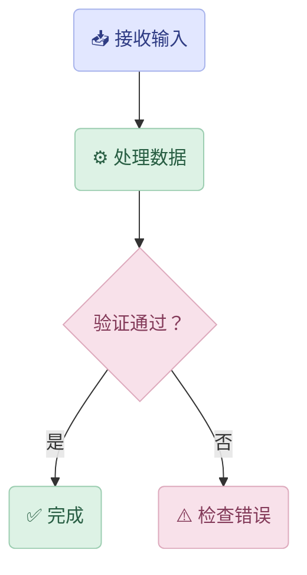

> [!bug]
> Contents# 测试我的流程图

# Callout Gallery · Material You × Macaron

> [!note] Note
> 普通笔记：记录信息、背景和补充说明。

> [!abstract] Abstract
> 内容摘要：用几句话总结整篇笔记。
>
> 别名测试：summary、tldr。

> [!info] Info
> 信息提示：这里放需要注意的客观信息。

> [!todo] Todo
> 待办事项：检查 Callout Customizer 的样式。
>
> 别名测试：check、done 属于 success，不属于 todo。

> [!tip] Tip
> 技巧提示：使用 CSS 变量统一管理配色。
>
> 别名测试：hint、important。

> [!success] Success
> 成功状态：样式已经成功加载。
>
> 别名测试：check、done。

> [!question] Question
> 问题：这套样式在深色模式下是否正常？
>
> 别名测试：help、faq。

> [!warning] Warning
> 警告：注意插件 CSS 与主题 CSS 的优先级。
>
> 别名测试：caution、attention。

> [!failure] Failure
> 失败状态：某个样式没有生效。
>
> 别名测试：fail、missing。

> [!danger] Danger
> 危险提示：修改 CSS 前先备份原文件。
>
> 别名测试：error。

> [!bug] Bug
> 缺陷记录：图标或颜色与预期不一致。

> [!example] Example
> 示例：用这张卡片检查标题、正文和图标的间距。

> [!quote] Quote
> 引用：好的界面设计让信息层级清晰，而不是让每个元素都大喊大叫。
>
> 别名测试：cite。

---

## Alias Tests · 别名测试

> [!summary] Summary
> abstract 的别名。

> [!tldr] TLDR
> abstract 的另一个别名。

> [!hint] Hint
> tip 的别名。

> [!important] Important
> tip 的另一个别名。

> [!check] Check
> success 的别名。

> [!done] Done
> success 的另一个别名。

> [!help] Help
> question 的别名。

> [!faq] FAQ
> question 的另一个别名。

> [!caution] Caution
> warning 的别名。

> [!attention] Attention
> warning 的另一个别名。

> [!fail] Fail
> failure 的别名。

> [!missing] Missing
> failure 的另一个别名。

> [!error] Error
> danger 的别名。

> [!cite] Cite
> quote 的别名。

---

## Folding Tests · 折叠测试

> [!tip]+ 默认展开
> 这个卡片初始展开，点击标题可以折叠。

> [!warning]- 默认折叠
> 这个卡片初始折叠，点击标题可以展开。

> [!note] 仅标题

> [!info |i:svg-summary] Info
> 信息提示：这里放需要注意的客观信息。