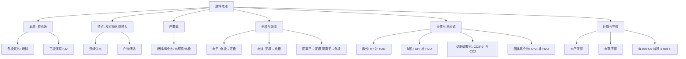

---
tags:
  - 化学/电化学
  - 化学/无机化学
  - 高中
date: 2026-10-05
---

# 专题：化学电源（燃料电池）

> [!info] 核心原理
> - 燃料电池是把**燃料（还原剂）与氧化剂（通常为 $\ce{O2}$）反应**产生的化学能，**直接转化为电能**的装置
> - 本质仍是**原电池**：**负极失电子（氧化）、正极得电子（还原）**
> - 关键特点：反应物**不在电池内部储存**，而是**由外部持续通入**、产物不断排出 → 可**连续稳定供电**
> - 解题主线：**写总反应 → 拆电极反应 → 判断介质 → 配平电荷**

## 一、本质与特点

> [!note] 燃料电池 vs 普通化学电池
> | 对比项 | 普通化学电池（如锌锰干电池） | 燃料电池 |
> |---|---|---|
> | 反应物位置 | 储存在电池**内部** | **外部通入** |
> | 供电时长 | 反应物耗尽即停止 | 持续供料则**持续供电** |
> | 电极是否消耗 | 电极常参与反应、逐渐消耗 | 多为**催化惰性电极**，本身不消耗 |
> | 能量利用率 | 较低 | **较高**（不经热机环节） |
> | 产物 | 复杂 | **清洁**（如 $\ce{H2 + O2 -> H2O}$） |

> [!tip] 一句话抓区别
> 干电池是"**自带干粮**"，燃料电池是"**边吃边干**"。

> [!abstract] 能量转化路径
> 燃料的**化学能** →（原电池装置）→ **电能** + 少量热能
> 对比燃烧发电：化学能 → 热能 → 机械能 → 电能，环节多、损耗大。

- **优点①** 能量转化效率高（不受卡诺循环限制）
- **优点②** 污染小、产物清洁（$\ce{H2}$ 作燃料的产物只有 $\ce{H2O}$，可实现"零排放"）
- **优点③** 可连续供电、功率可调（由通料量决定输出）
- **优点④** 燃料来源广（$\ce{H2}$、$\ce{CH4}$、$\ce{CH3OH}$、$\ce{C2H5OH}$、$\ce{N2H4}$、$\ce{CO}$ 等）

## 二、燃料电池的"四要素"

> [!important] 四要素
> - **燃料**：负极反应物，如 $\ce{H2, CH4, CH3OH, C2H5OH, N2H4, CO}$
> - **氧化剂**：正极反应物，通常为 $\ce{O2}$（空气）
> - **电解质**：决定内电路离子迁移与**配平方式**——酸性、碱性、熔融碳酸盐、固体氧化物
> - **电极**：惰性导电电极（**多孔碳电极、Pt 电极**），多孔**增大接触面积**、Pt 起**催化**作用

> [!warning] 电极常识
> - 燃料电池的**电极本身通常不参与反应**（不同于 Zn-Cu 原电池中锌片被消耗）
> - 燃料气/液需**充分接触电极与催化剂**才能发生电极反应

## 三、正负极与电子·离子流向

> [!important] 正负极判定
> - **通燃料的一极 = 负极**（燃料被氧化，$\ce{e-}$ 流出）
> - **通 $\ce{O2}$（空气）的一极 = 正极**（$\ce{O2}$ 被还原，$\ce{e-}$ 流入）

> [!note] 三类"方向"辨析
> - **电子**：**负极 → 外电路 → 正极**
> - **电流**：**正极 → 外电路 → 负极**（与电子方向相反）
> - **内电路离子**：**阳离子移向正极，阴离子移向负极**
>   - 酸性介质：$\ce{H+}$ 移向正极
>   - 碱性介质：$\ce{OH-}$ 移向负极
>   - 熔融碳酸盐：$\ce{CO3^2-}$ 移向负极
>   - 固体氧化物：$\ce{O^2-}$ 移向负极

> [!tip] 记忆口诀
> **负氧正还**（负极氧化、正极还原）；**电子出负极、进正极**；**阳离子奔正极、阴离子奔负极**。

## 四、不同介质下的电极反应式书写

> [!important] 配平总法则
> 1. 先写**总反应**（燃料 + $\ce{O2}$ → 产物），并配平
> 2. 写出**较简单的一极**（多数情况下正极 $\ce{O2}$ 更好写）
> 3. 用**总反应 − 已写极**得到另一极
> 4. 按介质**补 $\ce{H+}/\ce{OH-}/\ce{CO3^2-}/\ce{O^2-}$ 与 $\ce{H2O}$**，使**电荷守恒 + 原子守恒**

### 4.1 酸性介质（如稀 $\ce{H2SO4}$）

> [!example] 氢氧燃料电池（酸性）
> - 总反应：$\ce{2H2 + O2 -> 2H2O}$
> - 正极：$\ce{O2 + 4H+ + 4e- -> 2H2O}$
> - 负极：$\ce{2H2 - 4e- -> 4H+}$
> - 内电路：$\ce{H+}$ 移向**正极**

> [!note] 介质特征
> - 补给物用 **$\ce{H+}$**（不能出现 $\ce{OH-}$）
> - 产物中出现的水可保留

### 4.2 碱性介质（如 $\ce{KOH}$ 溶液）

> [!example] 氢氧燃料电池（碱性）
> - 总反应：$\ce{2H2 + O2 -> 2H2O}$
> - 正极：$\ce{O2 + 2H2O + 4e- -> 4OH-}$
> - 负极：$\ce{2H2 + 4OH- - 4e- -> 4H2O}$
> - 内电路：$\ce{OH-}$ 移向**负极**

> [!warning] 碱性介质铁律
> - **不能出现 $\ce{H+}$**，一律用 **$\ce{OH-}$ 和 $\ce{H2O}$** 配平
> - 正极在碱性下常写为 $\ce{O2 + 2H2O + 4e- -> 4OH-}$

### 4.3 熔融碳酸盐介质（如 $\ce{Li2CO3/Na2CO3}$，高温）

> [!example] 燃料电池（熔融碳酸盐）
> - 正极：$\ce{O2 + 2CO2 + 4e- -> 2CO3^2-}$
> - 负极（以 $\ce{H2}$ 为例）：$\ce{H2 + CO3^2- - 2e- -> H2O + CO2}$
> - 负极（以 $\ce{CH4}$ 为例）：$\ce{CH4 + 4CO3^2- - 8e- -> 5CO2 + 2H2O}$
> - 内电路：$\ce{CO3^2-}$ 移向**负极**

> [!tip] 熔融碳酸盐要点
> - 高温下**没有水溶液**，配平用 **$\ce{CO3^2-}$ 与 $\ce{CO2}$**，**不出现 $\ce{H+}/\ce{OH-}$**
> - $\ce{CO2}$ 既是"载体"又是产物，题干常问"是否需要补充 $\ce{CO2}$"

### 4.4 固体氧化物介质（如 $\ce{ZrO2}$，高温传导 $\ce{O^2-}$）

> [!example] 燃料电池（固体氧化物）
> - 正极：$\ce{O2 + 4e- -> 2O^2-}$
> - 负极（以 $\ce{H2}$ 为例）：$\ce{H2 + O^2- - 2e- -> H2O}$
> - 内电路：$\ce{O^2-}$ 移向**负极**

> [!note] 固体氧化物要点
> - 配平只用 **$\ce{O^2-}$ 与 $\ce{H2O}$**，不涉及 $\ce{H+}/\ce{OH-}/\ce{CO3^2-}$
> - 典型工作温度很高（数百至上千度）

### 4.5 四种介质对照表

> [!important] 介质—配平速查表
> | 介质 | 迁移离子 | 迁移方向 | 配平补给物 | 禁止出现 |
> |---|---|---|---|---|
> | 酸性 | $\ce{H+}$ | → 正极 | $\ce{H+}$、$\ce{H2O}$ | $\ce{OH-}$ |
> | 碱性 | $\ce{OH-}$ | → 负极 | $\ce{OH-}$、$\ce{H2O}$ | $\ce{H+}$ |
> | 熔融碳酸盐 | $\ce{CO3^2-}$ | → 负极 | $\ce{CO3^2-}$、$\ce{CO2}$ | $\ce{H+}$、$\ce{OH-}$ |
> | 固体氧化物 | $\ce{O^2-}$ | → 负极 | $\ce{O^2-}$、$\ce{H2O}$ | $\ce{H+}$、$\ce{OH-}$ |

## 五、常见燃料电池类型

> [!example] ① 氢氧燃料电池
> - 总反应：$\ce{2H2 + O2 -> 2H2O}$（最清洁，产物只有水）
> - 酸性正极：$\ce{O2 + 4H+ + 4e- -> 2H2O}$；酸性负极：$\ce{2H2 - 4e- -> 4H+}$
> - 碱性正极：$\ce{O2 + 2H2O + 4e- -> 4OH-}$；碱性负极：$\ce{2H2 + 4OH- - 4e- -> 4H2O}$

> [!example] ② 甲烷燃料电池
> - 总反应（碱性）：$\ce{CH4 + 2O2 + 2OH- -> CO3^2- + 3H2O}$
> - 碱性正极：$\ce{2O2 + 4H2O + 8e- -> 8OH-}$
> - 碱性负极：$\ce{CH4 + 10OH- - 8e- -> CO3^2- + 7H2O}$
> - 提示：碳元素最终转化为 **$\ce{CO3^2-}$（碱性）** 或 **$\ce{CO2}$（酸性/熔融盐）**

> [!example] ③ 甲醇燃料电池
> - 总反应（酸性）：$\ce{2CH3OH + 3O2 -> 2CO2 + 4H2O}$
> - 酸性正极：$\ce{3O2 + 12H+ + 12e- -> 6H2O}$
> - 酸性负极：$\ce{2CH3OH + 2H2O - 12e- -> 2CO2 + 12H+}$
> - 碱性介质中碳元素则转化为 $\ce{CO3^2-}$

> [!example] ④ 乙醇燃料电池
> - 总反应（酸性）：$\ce{C2H5OH + 3O2 -> 2CO2 + 3H2O}$
> - 酸性负极：$\ce{C2H5OH + 3H2O - 12e- -> 2CO2 + 12H+}$
> - 属于"高能量密度液态燃料"，便于储运

> [!example] ⑤ 肼（$\ce{N2H4}$）燃料电池
> - 碱性总反应：$\ce{N2H4 + O2 -> N2 + 2H2O}$
> - 碱性正极：$\ce{O2 + 2H2O + 4e- -> 4OH-}$
> - 碱性负极：$\ce{N2H4 + 4OH- - 4e- -> N2 + 4H2O}$
> - 特点：产物为**氮气和水**，污染极小，可用于航天

> [!example] ⑥ 一氧化碳燃料电池
> - 酸性负极：$\ce{CO + H2O - 2e- -> CO2 + 2H+}$
> - 碱性介质中碳元素转化为 $\ce{CO3^2-}$：$\ce{CO + 4OH- - 2e- -> CO3^2- + 2H2O}$

> [!tip] 各类型共性
> - **负极都是燃料失电子**；**正极都是 $\ce{O2}$ 得电子**
> - 写出**燃料中 C / N / H 的最终价态产物**，是配平的关键
> - 有机燃料的 $\ce{e-}$ 转移数 = 各元素化合价变化之和

## 六、计算与定量关系

> [!important] 三大守恒
> - **电子守恒**：负极失去的电子数 = 正极得到的电子数 = 外电路通过的电子数
> - **电荷守恒**：每个电极反应式两边**电荷数相等**（检验配平的重要方法）
> - **原子守恒**：先配平原子，再配平电荷

> [!note] 常用定量关系
> - $\ce{O2 + 4e-}$：**每 1 mol $\ce{O2}$ 转移 4 mol $\ce{e-}$**（碱性、酸性、熔融盐、固体氧化物均相同）
> - $\ce{H2 - 2e-}$：每 1 mol $\ce{H2}$ 转移 2 mol $\ce{e-}$
> - 电量：$Q = n(\ce{e-}) \times F$（$F \approx 96500\ \mathrm{C/mol}$）
> - 电量与气体体积：$n(\ce{e-}) \leftrightarrow V$（标准状况 $22.4\ \mathrm{L/mol}$）

> [!tip] 解题套路
> 1. **写总反应**并配平
> 2. 用**转移电子数**把燃料、$\ce{O2}$、产物、电量串起来
> 3. **电解质溶液 pH 变化**：看是否消耗/生成 $\ce{H+}$ 或 $\ce{OH-}$
>    - 酸性介质：$\ce{H+}$ 被消耗 → **pH 增大**
>    - 碱性介质：$\ce{OH-}$ 被消耗 → **pH 减小**

## 七、常见易错点

> [!warning] 易错警示
> - 燃料电池**不是"燃料燃烧"**，而是在电极上**分步发生氧化还原**，不经过点燃
> - **通燃料的是负极、通 $\ce{O2}$ 的是正极**，别正负颠倒
> - **电子只走外电路，离子只走内电路**；电子不能"穿过溶液"
> - 配平**必须匹配介质**：碱性介质中写出 $\ce{H+}$、酸性介质中写出 $\ce{OH-}$ 都属于错误
> - 碱性介质下 **$\ce{CO2}$ 不能存在**，碳的产物要写成 $\ce{CO3^2-}$（或 $\ce{HCO3-}$）
> - 熔融碳酸盐、固体氧化物电解质中**无水溶液**，不要出现 $\ce{OH-}$
> - 固体氧化物的 $\ce{O^2-}$ 与熔融碳酸盐的 $\ce{CO3^2-}$ 都移向**负极**，不要与酸性/碱性搞混
> - 电极反应式**两边电荷必须相等**，配平后一定要做**电荷检验**
> - 计算时注意**"每 mol $\ce{O2}$ 转移 4 mol $\ce{e-}$"**，不要把 2 mol 当标准

## 八、思维导图（燃料电池总纲）

