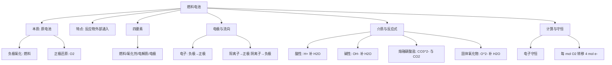

---
tags:
  - 化学/电化学
  - 化学/无机化学
  - 高中
date: 2026-10-05
---

# 专题：化学电源（燃料电池）

> [!info] 核心原理
> - 本质是**原电池**：**燃料在负极被氧化、$\ce{O2}$ 在正极被还原**
> - 反应物**由外部持续通入**，产物不断排出 → 可**连续供电**
> - 解题主线：**总反应 → 拆电极 → 匹配介质 → 用电荷守恒配平**

## 一、本质与特点

| 对比项 | 普通化学电池 | 燃料电池 |
|---|---|---|
| 反应物位置 | 储存在电池内部 | **外部通入** |
| 供电时长 | 反应物耗尽即停 | 持续供料即**持续供电** |
| 电极 | 常参与反应、逐渐消耗 | **惰性电极**，本身不消耗 |
| 能量利用率 | 较低 | **较高**（不经热机环节） |
| 产物 | 复杂 | **清洁**（$\ce{H2}$ 燃料产物只有 $\ce{H2O}$） |

**四要素**：燃料（负极）· 氧化剂 $\ce{O2}$（正极）· 电解质（决定配平方式）· 电极（多孔碳 / $\ce{Pt}$，起导电与催化作用）。

**优点**：效率高、污染小、可连续供电、燃料来源广（$\ce{H2, CH4, CH3OH, C2H5OH, N2H4, CO}$）。

## 二、正负极与电子·离子流向

- **通燃料的一极 = 负极**（氧化，$\ce{e-}$ 流出）
- **通 $\ce{O2}$ 的一极 = 正极**（还原，$\ce{e-}$ 流入）

| 方向 | 说明 |
|---|---|
| 电子 | 负极 → 外电路 → 正极 |
| 电流 | 正极 → 外电路 → 负极（与电子相反） |
| 内电路离子 | **阳离子移向正极，阴离子移向负极** |

> [!tip] 记忆口诀
> **负氧正还**；电子出负极、进正极；阳离子奔正极、阴离子奔负极。

## 三、四种介质下的标准电极反应式

> [!important] 一句话总规律
> **负极写燃料失电子，正极恒为 $\ce{O2}$ 得电子；配平用哪对物质由介质决定。**

### 3.1 介质—配平速查

| 介质 | 迁移离子 | 方向 | 配平用物质 | 禁止出现 |
|---|---|---|---|---|
| 酸性 | $\ce{H+}$ | → 正极 | $\ce{H+}$、$\ce{H2O}$ | $\ce{OH-}$ |
| 碱性 | $\ce{OH-}$ | → 负极 | $\ce{OH-}$、$\ce{H2O}$ | $\ce{H+}$ |
| 熔融碳酸盐 | $\ce{CO3^2-}$ | → 负极 | $\ce{CO3^2-}$、$\ce{CO2}$ | $\ce{H+}$、$\ce{OH-}$ |
| 固体氧化物 | $\ce{O^2-}$ | → 负极 | $\ce{O^2-}$、$\ce{H2O}$ | $\ce{H+}$、$\ce{OH-}$ |

### 3.2 各介质下 $\ce{O2}$（正极）的标准写法

| 介质 | 正极反应式（$\ce{O2}$ 得电子） |
|---|---|
| 酸性 | $\ce{O2 + 4H+ + 4e- -> 2H2O}$ |
| 碱性 | $\ce{O2 + 2H2O + 4e- -> 4OH-}$ |
| 熔融碳酸盐 | $\ce{O2 + 2CO2 + 4e- -> 2CO3^2-}$ |
| 固体氧化物 | $\ce{O2 + 4e- -> 2O^2-}$ |

**规律**：不论何种介质，**每 1 mol $\ce{O2}$ 都转移 4 mol $\ce{e-}$**，只是"补水/补离子"的形式不同。

### 3.3 各介质下燃料（负极）的标准写法

| 介质 | 以 $\ce{H2}$ 为燃料 | 以 $\ce{CH4}$ 为燃料 |
|---|---|---|
| 酸性 | $\ce{H2 - 2e- -> 2H+}$ | $\ce{CH4 + 2H2O - 8e- -> CO2 + 8H+}$ |
| 碱性 | $\ce{H2 + 2OH- - 2e- -> 2H2O}$ | $\ce{CH4 + 10OH- - 8e- -> CO3^2- + 7H2O}$ |
| 熔融碳酸盐 | $\ce{H2 + CO3^2- - 2e- -> H2O + CO2}$ | $\ce{CH4 + 4CO3^2- - 8e- -> 5CO2 + 2H2O}$ |
| 固体氧化物 | $\ce{H2 + O^2- - 2e- -> H2O}$ | $\ce{CH4 + 4O^2- - 8e- -> CO2 + 2H2O}$ |

**规律**：碳元素在**酸性/固体氧化物**中最终变成 **$\ce{CO2}$**，在**碱性**中变成 **$\ce{CO3^2-}$**，在**熔融碳酸盐**中参与 $\ce{CO3^2-}$ 转化并生成 $\ce{CO2}$。

### 3.4 含氮燃料（$\ce{N2H4}$）的负极标准写法

- 碱性：$\ce{N2H4 + 4OH- - 4e- -> N2 + 4H2O}$
- 酸性：$\ce{N2H4 - 4e- -> N2 + 4H+}$
- 特点：产物为**氮气和水**，污染极小。

## 四、常见燃料的总反应

| 燃料 | 总反应（以碱性为例） |
|---|---|
| $\ce{H2}$ | $\ce{2H2 + O2 -> 2H2O}$ |
| $\ce{CH4}$ | $\ce{CH4 + 2O2 + 2OH- -> CO3^2- + 3H2O}$ |
| $\ce{CH3OH}$ | $\ce{2CH3OH + 3O2 + 4OH- -> 2CO3^2- + 6H2O}$ |
| $\ce{C2H5OH}$ | $\ce{C2H5OH + 3O2 + 4OH- -> 2CO3^2- + 5H2O}$ |
| $\ce{N2H4}$ | $\ce{N2H4 + O2 -> N2 + 2H2O}$ |
| $\ce{CO}$ | $\ce{2CO + O2 -> 2CO2}$ |

**酸性介质**中把 $\ce{CO3^2-}$ 换成 $\ce{CO2}$ 即可（酸碱介质总反应差别就在碳的产物形态）。

## 五、计算与守恒

- **电子守恒**：负极失电子数 = 正极得电子数
- **电荷守恒**：电极反应式两边电荷数必须相等（配平后必查）
- **定量关系**：每 1 mol $\ce{O2}$ → 4 mol $\ce{e-}$；$Q = n(\ce{e-}) \times F$（$F\approx96500\ \mathrm{C/mol}$）
- **pH 变化**：酸性介质消耗 $\ce{H+}$ → pH 增大；碱性介质消耗 $\ce{OH-}$ → pH 减小

## 六、常见易错点

> [!warning] 易错警示
> - 燃料电池**不是燃烧**，是在电极上分步发生氧化还原
> - **通燃料的是负极、通 $\ce{O2}$ 的是正极**，别颠倒
> - **电子只走外电路，离子只走内电路**，电子不穿过溶液
> - 配平必须匹配介质：碱性介质不能写 $\ce{H+}$，酸性介质不能写 $\ce{OH-}$
> - 碱性介质中 **$\ce{CO2}$ 不存在**，碳的产物要写成 $\ce{CO3^2-}$
> - 熔融碳酸盐、固体氧化物中**无水溶液**，不出现 $\ce{OH-}$
> - 固体氧化物的 $\ce{O^2-}$、熔融碳酸盐的 $\ce{CO3^2-}$ 都移向**负极**
> - 计算时牢记"**每 mol $\ce{O2}$ 转移 4 mol $\ce{e-}$**"

## 七、思维导图（总纲）

