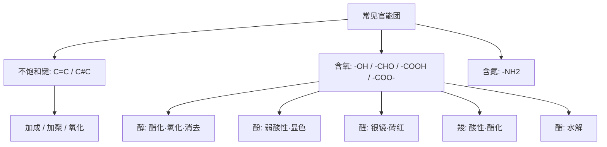

---
tags:
  - 化学/有机化学
  - 高中/必修二
date: 2026-10-05
---

# 常见官能团总结

> [!info] 核心思路
> 官能团 = **决定有机物化学性质的原子或原子团**。学有机化学的核心方法：
> **认官能团 → 推性质 → 写反应类型**。同一官能团在不同物质中性质相同，这是"结构决定性质"的直接体现。

## 一、官能团一览表

| 官能团 | 结构式 | 代表物质 | 主要性质 / 反应 |
|--------|--------|----------|-----------------|
| 碳碳双键 | $\ce{C=C}$ | 乙烯 $\ce{CH2=CH2}$ | 加成、加聚、氧化（使溴水/酸性 $\ce{KMnO4}$ 褪色） |
| 碳碳三键 | $\ce{C#C}$ | 乙炔 $\ce{CH#CH}$ | 加成、氧化 |
| 羟基（醇） | $\ce{-OH}$ | 乙醇 $\ce{C2H5OH}$ | 与 $\ce{Na}$ 反应放 $\ce{H2}$、酯化、催化氧化、消去 |
| 羟基（酚） | $\ce{-OH}$（连苯环） | 苯酚 $\ce{C6H5OH}$ | 弱酸性、与 $\ce{FeCl3}$ 显紫色、苯环取代 |
| 醛基 | $\ce{-CHO}$ | 乙醛 $\ce{CH3CHO}$ | 银镜反应、与新制 $\ce{Cu(OH)2}$ 反应、加氢还原 |
| 羰基（酮） | $\ce{>C=O}$ | 丙酮 | 加氢还原为醇，不发生银镜反应 |
| 羧基 | $\ce{-COOH}$ | 乙酸 $\ce{CH3COOH}$ | 酸性（弱酸）、酯化、与碳酸盐反应放 $\ce{CO2}$ |
| 酯基 | $\ce{-COO-}$ | 乙酸乙酯 | 水解（酸性/碱性条件） |
| 醚键 | $\ce{-O-}$ | 乙醚 | 较稳定，一般不特征反应 |
| 氨基 | $\ce{-NH2}$ | 苯胺、氨基酸 | 碱性 |

> [!tip] 记忆口诀
> **"双三键加成，醇酚醛羧酯"**——依次对应 加成 / 弱酸显色 / 银镜 / 酯化 / 水解。

## 二、按反应类型串起来

### 1. 加成反应（不饱和键断开）
$$\ce{CH2=CH2 + Br2 -> CH2Br-CH2Br}$$
- 能加成：$\ce{C=C}$、$\ce{C#C}$、$\ce{-CHO}$、$\ce{>C=O}$、苯环（与 $\ce{H2}$）

### 2. 取代反应
- 烷烃卤代（光照）：$\ce{CH4 + Cl2 ->[光照] CH3Cl + HCl}$
- 苯环卤代（$\ce{Fe}$ 催化）、硝化（浓硫酸+浓硝酸，50~60℃）
- **酯化**：$\ce{CH3COOH + C2H5OH <=>[浓硫酸][\Delta] CH3COOC2H5 + H2O}$
- **水解**：$\ce{CH3COOC2H5 + NaOH ->[\Delta] CH3COONa + C2H5OH}$

### 3. 氧化反应
- 燃烧：有机物完全燃烧生成 $\ce{CO2}$ 和 $\ce{H2O}$
- 催化氧化（醇→醛）：$\ce{2C2H5OH + O2 ->[Cu/\Delta] 2CH3CHO + 2H2O}$
- 使酸性 $\ce{KMnO4}$ 褪色：$\ce{C=C}$、$\ce{C#C}$、醇、醛等

### 4. 消去反应
$$\ce{CH3CH2OH ->[浓硫酸][170^\circ C] CH2=CH2 ^ + H2O}$$

## 三、鉴别与检验（常考）

| 检验对象 | 试剂 / 方法 | 现象 |
|----------|-------------|------|
| $\ce{C=C}$ / $\ce{C#C}$ | 溴水 / 酸性 $\ce{KMnO4}$ | 溴水褪色 |
| 醛基 $\ce{-CHO}$ | 银氨溶液（水浴加热） | 银镜 |
| 醛基 $\ce{-CHO}$ | 新制 $\ce{Cu(OH)2}$（加热） | 砖红色沉淀 $\ce{Cu2O}$ |
| 酚羟基 | $\ce{FeCl3}$ 溶液 | 显紫色 |
| 羧基 | 石蕊 / 碳酸盐 | 变红 / 放出 $\ce{CO2}$ |

> [!warning] 易错点
> - 苯酚**不是**酸也不是醇：$\ce{-OH}$ 连在**苯环**上是酚，连在**链烃**上是醇，性质差别很大
> - 银镜反应需**水浴加热**，不能直接大火
> - 检验 $\ce{C=C}$ **优先用溴水**（颜色变化明显），$\ce{KMnO4}$ 会同时被醇等还原，不专一
> - 酯化反应中浓硫酸：**催化剂 + 吸水剂**，且"酸脱羟基醇脱氢"

## 四、思维导图

> [!tip] 延伸
> 想更进一步，可以把本表与 [[常见有机物总结]] 对照学，从"官能团"和"物质类别"两个视角双向巩固喵。
