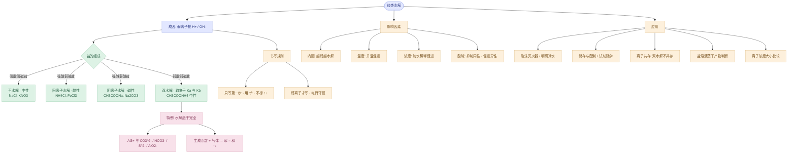
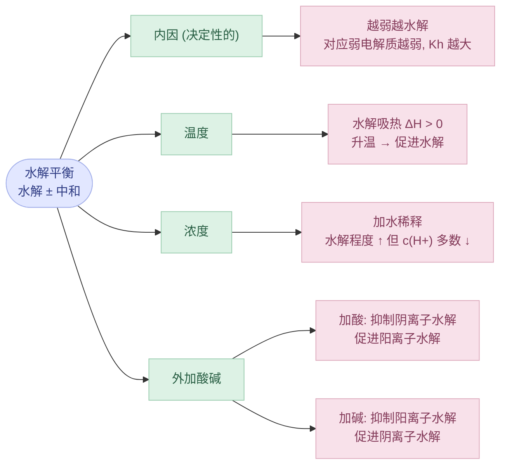

---
tags:
  - 化学/水溶液中的离子平衡
  - 化学/无机化学
  - 高中/选必一
date: 2026-10-20
---

# 专题：盐类的水解

> [!abstract] 一句话本质
> 水解 = 盐电离出的**弱**离子（弱酸根 / 弱碱阳离子）**抢走水里的 $\ce{H+}$ 或 $\ce{OH-}$**，从而把水的电离平衡向右推的反应。
> 它是**中和反应的逆反应**，是**可逆的、微弱的、吸热的、相互促进的**。

---

## 零、纵向主线（先看这张图再往下读）

---

## 一、水解的定义与本质

### 1.1 定义

> [!info] 标准表述
> 在水溶液中，**盐电离出的离子与水电离出的 $\ce{H+}$ 或 $\ce{OH-}$ 结合生成弱电解质**，从而**促进了水的电离**的反应，叫做盐类的水解。

**判定一个盐是否水解，只看一句话：能不能生成弱电解质。**

| 盐的类型 | 实例 | 谁水解 | 溶液酸碱性 |
|---|---|---|---|
| 强酸强碱盐 | $\ce{NaCl, KNO3, Na2SO4}$ | **都不水解** | 中性（pH = 7） |
| 强酸弱碱盐 | $\ce{NH4Cl, FeCl3, Al2(SO4)3}$ | **阳离子** | 酸性（pH < 7） |
| 强碱弱酸盐 | $\ce{CH3COONa, Na2CO3, NaHCO3}$ | **阴离子** | 碱性（pH > 7） |
| 弱酸弱碱盐 | $\ce{CH3COONH4, NH4HCO3}$ | **两者都水解** | 看 $K_a$ 与 $K_b$ 谁大 |

> [!tip] 口诀
> **有弱才水解，都弱都水解，越弱越水解，谁强显谁性。**
> 注意：弱酸弱碱盐**不能**用"谁强显谁性"，因为酸碱性由 $K_a$ 和 $K_b$ 的相对大小决定。

### 1.2 本质：水解促电离

水的电离是：$\ce{H2O <=> H+ + OH-}$

盐的弱离子把其中一个抓走，产物浓度降低 → 平衡右移 → **水的电离被促进**（这是和"加酸加碱抑制水电离"相反的方向）。

> [!important] 这一点是高考最爱考的因果链
> **水解越强 → 水的电离程度越大 → 水电离出的 $c(\ce{H+})$ 或 $c(\ce{OH-})$ 越大**
> 反过来，**加酸或加碱抑制水电离**。所以比较"水电离程度"时，先看溶液里有没有水解的盐。

| 溶液（均为 0.1 mol·L⁻¹） | 水电离出的 $c(\ce{H+})$/$\ce{OH-}$ | 理由 |
|---|---|---|
| $\ce{NaOH}$ | $10^{-13}$ | 外加 $\ce{OH-}$ 抑制 |
| $\ce{NaCl}$ | $10^{-7}$ | 不水解 |
| $\ce{CH3COONa}$ | $>10^{-7}$ | 水解促进 |
| $\ce{FeCl3}$ | $>10^{-7}$ | 水解促进 |

---

## 二、水解方程式的书写

> [!warning] 六条铁律（考试按点给分）
> 1. **用 $\ce{<=>}$**，不用 $\ce{->}$（可逆、微弱）
> 2. **不标"↑""↓"**（产物浓度极小，不逸出、不沉淀）
> 3. **弱离子只写第一步**，不写第二步（后续水解极弱，可以忽略）
> 4. **不拆**弱酸分子、弱碱分子、沉淀、气体、水（$\ce{H2CO3}$ 不拆成 $\ce{CO2 + H2O}$）
> 5. **电荷守恒**：两边电荷总数必须相等（配平后必查）
> 6. **多元弱酸根分步写**，多元弱碱阳离子**一次写完**

### 2.1 三类典型写法

| 类型 | 方程式 | 说明 |
|---|---|---|
| 强碱弱酸盐 | $\ce{CH3COO- + H2O <=> CH3COOH + OH-}$ | 生成弱酸，显碱性 |
| 强酸弱碱盐 | $\ce{NH4+ + H2O <=> NH3.H2O + H+}$ | 生成弱碱，显酸性 |
| 多元弱碱阳离子 | $\ce{Fe3+ + 3H2O <=> Fe(OH)3 + 3H+}$ | **一步写完**，不拆成三步 |

> [!warning] $\ce{NH3.H2O}$ 不能拆
> $\ce{NH4+ + H2O <=> NH3.H2O + H+}$ 是对的；写成 $\ce{NH3 + H2O + H+}$ 是错的。
> 同理 $\ce{H2CO3}$、$\ce{CH3COOH}$ 在方程式里都写分子形式。

### 2.2 多元弱酸根：为什么只写第一步

以 $\ce{Na2CO3}$ 为例：

$$
\begin{aligned}
\text{第一步：}&\quad \ce{CO3^2- + H2O <=> HCO3- + OH-}\\
\text{第二步：}&\quad \ce{HCO3- + H2O <=> H2CO3 + OH-}
\end{aligned}
$$

两步的水解常数可以用"**$K_h = K_w / K_a$**"算出来（$K_a$ 取对应的那一步）：

| 水解步骤 | 平衡常数表达式 | 数值（取 $K_{a1}(\ce{H2CO3})=4.5\times10^{-7}$，$K_{a2}=4.7\times10^{-11}$） |
|---|---|---|
| $\ce{CO3^2-}$ 第一步 | $K_h1 = K_w / K_{a2}$ | $\approx 2.1\times10^{-4}$ |
| $\ce{HCO3-}$ 第二步 | $K_h2 = K_w / K_{a1}$ | $\approx 2.2\times10^{-8}$ |

第一步比第二步大**约 4 个数量级**，所以第二步产生的 $\ce{OH-}$ 可以忽略。

> [!example] 顺手算个数（0.1 mol·L⁻¹ $\ce{Na2CO3}$）
> 用 $K_h1$ 近似：$x^2/(0.1-x)\approx 2.1\times10^{-4}$ → $x\approx 4.5\times10^{-3}$ mol·L⁻¹
> **水解度约 4.5%**，$\mathrm{pH}\approx 11.6$。
> 结论：水解是**"微弱"但不是"无穷小"**，教材里的"极弱"只是相对电离而言。

> [!tip] 反过来用
> 写 $\ce{NaHCO3}$ 水解时要写 $\ce{HCO3- + H2O <=> H2CO3 + OH-}$。
> 但 $\ce{NaHCO3}$ 溶液显**碱性**，原因是**水解 > 电离**（$K_h2 \approx 2.2\times10^{-8} > K_{a2}\approx 4.7\times10^{-11}$）。
> 而 $\ce{NaHSO3}$、$\ce{NaH2PO4}$ 显**酸性**，因为**电离 > 水解**。**这类"酸式盐显什么性"必须比较两个常数**，死记容易翻车喵。

---

## 三、双水解

### 3.1 定义与两种情形

> [!info] 双水解
> 弱酸弱碱盐中，**弱酸根和弱碱阳离子同时水解**，且两者的水解产物能**互相消耗**（一方产 $\ce{H+}$、一方产 $\ce{OH-}$），从而**相互促进**。

| 情形 | 特征 | 能否进行到底 | 方程式写法 |
|---|---|---|---|
| **一般双水解** | 两者都水解，但产物仍留在溶液里 | 不能，存在水解平衡 | $\ce{<=>}$（如 $\ce{NH4+}$ + $\ce{CH3COO-}$） |
| **完全双水解** | 生成**沉淀和/或气体**，脱离体系 | 能，几乎进行到底 | $\ce{->}$ + **↑↓** |

### 3.2 常见弱酸弱碱盐的酸碱性速查

| 盐                | $K_a$ vs $K_b$                             | 溶液性    | 结论   |
| ---------------- | ------------------------------------------ | ------ | ---- |
| $\ce{CH3COONH4}$ | $K_a \approx K_b \approx 1.8\times10^{-5}$ | **中性** | 恰好抵消 |
| $\ce{NH4HCO3}$   | $K_b(\ce{NH3}) > K_a1(\ce{H2CO3})$         | **碱性** | 碱强于酸 |
| $\ce{NH4F}$      | $K_a(\ce{HF}) > K_b(\ce{NH3})$             | **酸性** | 酸强于碱 |
| $\ce{(NH4)2S}$   | $K_b(\ce{NH3}) > K_a2(\ce{H2S})$           | **碱性** | 碱强于酸 |

> [!warning] 弱酸弱碱盐**不能用**"谁强显谁性"
> 这句口诀只适用于"一强一弱"的盐。对 $\ce{NH4HCO3}$ 这种，必须拿 $K_a$ 和 $K_b$ 比大小。

### 3.3 完全双水解（必背清单）

> [!important] $\ce{Al3+}$ 的"三大死对头" + 常用组合
> - $\ce{Al3+}$ 与 $\ce{CO3^2-}$ / $\ce{HCO3-}$ / $\ce{S^2-}$ / $\ce{HS-}$ / $\ce{AlO2-}$ / $\ce{ClO-}$ / $\ce{SiO3^2-}$
> - $\ce{Fe3+}$ 与 $\ce{CO3^2-}$ / $\ce{HCO3-}$ / $\ce{AlO2-}$ / $\ce{SiO3^2-}$
> - $\ce{NH4+}$ 与 $\ce{AlO2-}$ / $\ce{SiO3^2-}$（$\ce{NH4+}$ 产 $\ce{H+}$，$\ce{AlO2-}$ 抢 $\ce{H+}$）
> - $\ce{Al3+}$ 与 **$\ce{NH4+}$ 共存**（$\ce{NH4+}$ 产 $\ce{H+}$ → 抑制 $\ce{Al3+}$ 水解，**可以共存**）

| 组合 | 完全水解方程式 | 现象 |
|---|---|---|
| $\ce{Al3+ + CO3^2-}$ | $\ce{2Al^3+ + 3CO3^2- + 3H2O -> 2Al(OH)3 v + 3CO2 ^}$ | 白色沉淀 + 气泡 |
| $\ce{Al3+ + HCO3-}$ | $\ce{Al^3+ + 3HCO3- -> Al(OH)3 v + 3CO2 ^}$ | 白沉 + 剧烈冒泡 |
| $\ce{Al3+ + S^2-}$ | $\ce{2Al^3+ + 3S^2- + 6H2O -> 2Al(OH)3 v + 3H2S ^}$ | 白沉 + 臭鸡蛋味 |
| $\ce{Al3+ + AlO2-}$ | $\ce{Al^3+ + 3AlO2- + 6H2O -> 4Al(OH)3 v}$ | 只有白沉 |
| $\ce{Al3+ + SiO3^2-}$ | $\ce{2Al^3+ + 3SiO3^2- + 6H2O -> 2Al(OH)3 v + 3H2SiO3 v}$ | 两种白色胶状沉淀 |
| $\ce{Fe3+ + CO3^2-}$ | $\ce{2Fe^3+ + 3CO3^2- + 3H2O -> 2Fe(OH)3 v + 3CO2 ^}$ | 红褐沉淀 + 气泡 |
| $\ce{NH4+ + AlO2-}$ | $\ce{NH4+ + AlO2- + 2H2O -> Al(OH)3 v + NH3.H2O}$ | 白沉 |
| $\ce{NH4+ + SiO3^2-}$ | $\ce{2NH4+ + SiO3^2- -> H2SiO3 v + 2NH3 ^}$ | 白沉 + 气体 |

> [!tip] 快速配平法（不用背系数）
> **先写"沉淀 + 弱酸/弱碱"两边，再用水补齐 H、O，最后查电荷。**
> 例：$\ce{Al^3+ + HCO3- -> Al(OH)3 + CO2}$，左边缺 3 个 H 和 3 个 O，补 3 个 $\ce{H2O}$，系数自然出来。
> 也可以用**电荷守恒校验**：$\ce{Al^3+ + 3HCO3-}$ 左边电荷 $3-3=0$，右边全中性，必然对。

### 3.4 双水解的两个"坑"

> [!danger] 高频陷阱
> 1. **$\ce{Al3+}$ 与 $\ce{NH4+}$ 能大量共存**（互相抑制，$\ce{NH4+}$ 提供 $\ce{H+}$ 抑制 $\ce{Al3+}$ 水解）
> 2. **$\ce{AlO2-}$ 与 $\ce{HCO3-}$ 不共存**：$\ce{AlO2- + HCO3- + H2O -> Al(OH)3 v + CO3^2-}$（弱酸制更弱酸，不是氧化还原）
> 3. **$\ce{Fe3+}$ 与 $\ce{I-}$ 不共存的原因是氧化还原**，不是双水解；$\ce{Fe3+}$ 与 $\ce{SCN-}$ 是络合。判题时别把三类原因混淆。
> 4. **"不共存"和"不存在"**：$\ce{Al2S3}$ 不能在溶液中制得，只能干态合成。

---

## 四、影响盐类水解的因素

### 4.1 总结构图

### 4.2 四条规则逐条拆

> [!important] ① 内因：越弱越水解
> 弱离子的对应弱电解质**越弱**（$K_a$ 或 $K_b$ 越小），结合 $\ce{H+}$/$\ce{OH-}$ 的越牢，$K_h = K_w / K$ 越大，水解越强。
> 例：等浓度**同价**的钠盐，碱性强弱 $\ce{Na2SiO3 > Na2CO3 > NaHCO3 > CH3COONa > NaNO2}$（对应酸 $\ce{H2SiO3 < H2CO3 < CH3COOH < HNO2}$）。
> ⚠️ **不同价时不能直接比**，比如 $\ce{Na2CO3}$ 和 $\ce{CH3COONa}$ 要按 $K_h$ 数值比，别凭"碳酸更弱"就下结论。

> [!important] ② 温度：升温促进水解
> 水解是中和的逆反应，中和放热 → **水解吸热**（$\Delta H > 0$）。
> 所以：**升温，水解程度增大**。这也是为什么 $\ce{FeCl3}$ 溶液加热会变深、变浑浊（$\ce{Fe(OH)3}$ 胶体），配制 $\ce{FeCl3}$ 时要**加盐酸抑制 + 不加热**。

> [!important] ③ 浓度：稀释促进水解
> 加水稀释 → 各离子浓度都下降 → 平衡向**粒子数增多**的一方（水解方向）移动 → **水解程度（百分率）增大**。
> 但注意：**程度增大 ≠ 浓度增大**。稀释时 $c(\ce{H+})$ 通常**减小**（除了极稀的情况），pH 向 7 靠拢。
>
> ⚠️ 这是最容易混的点：**"水解程度"和"水解产生离子的浓度"是两个方向**。画图/判断题里经常故意挖这个坑。

> [!important] ④ 外加酸碱：抑制"同性"、促进"异性"
> 以 $\ce{CH3COO- + H2O <=> CH3COOH + OH-}$ 为例：
> - 加 $\ce{NaOH}$ → 增加 $\ce{OH-}$ → **抑制**水解（但 $c(\ce{CH3COOH})$ 减小）
> - 加 $\ce{HCl}$ → 消耗 $\ce{OH-}$ → **促进**水解（$c(\ce{CH3COOH})$ 增大，$\ce{CH3COO-}$ 减少）
>
> 以 $\ce{NH4+ + H2O <=> NH3.H2O + H+}$ 为例，规律**正好反过来**。
> 记忆：**加什么就抑制生成什么的那一边。**

### 4.3 其他因素

| 因素 | 影响 | 例子 |
|---|---|---|
| 加入能反应的离子 | 消耗水解产物 → 促进水解 | 向 $\ce{FeCl3}$ 加 $\ce{NaOH}$ → 完全沉淀 |
| 加入相同弱酸/弱碱 | 增加产物 → 抑制 | 向 $\ce{CH3COONa}$ 加 $\ce{CH3COOH}$ |
| 盐的组成（价态） | 高价阳离子水解更明显 | $\ce{Al3+}$、$\ce{Fe3+}$ 比 $\ce{NH4+}$ 强得多 |

> [!example] 一道经典比较题
> **等浓度、等体积的 $\ce{CH3COONa}$、$\ce{Na2CO3}$、$\ce{NaHCO3}$ 溶液，pH 由大到小？**
> 答：$\ce{Na2CO3 > NaHCO3 > CH3COONa}$。
> 思路：$\ce{Na2CO3}$ 是二元弱酸根（$K_h \approx 2.1\times10^{-4}$），$\ce{NaHCO3}$ 的 $K_h \approx 2.2\times10^{-8}$，$\ce{CH3COONa}$ 的 $K_h = 10^{-14}/1.8\times10^{-5}\approx 5.6\times10^{-10}$。
> 但注意 $\ce{NaHCO3}$ 还要考虑电离（$K_{a2}\approx 4.7\times10^{-11}$），净效果仍是水解占优 → 碱性。**排序必须用 $K_h$ 数值，不能只看"酸的强弱感觉"。**

---

## 五、水解的应用

### 5.1 生活与工业

| 应用 | 原理 | 关键方程式 / 要点 |
|---|---|---|
| **泡沫灭火器** | 双水解快速产气 | $\ce{Al2(SO4)3 + 6NaHCO3 -> 2Al(OH)3 v + 3Na2SO4 + 6CO2 ^}$ |
| **明矾净水** | $\ce{Al3+}$ 水解生成胶体吸附悬浮物 | $\ce{Al^3+ + 3H2O <=> Al(OH)3(胶体) + 3H+}$ |
| **$\ce{FeCl3}$ 净水** | 同上，红褐色胶体 | 注意**胶体不是沉淀**，方程式仍用 $\ce{<=>}$ |
| **热碱去油污** | $\ce{CO3^2-}$ 水解显碱性，升温促进 | 用热的 $\ce{Na2CO3}$ 溶液洗油污 |
| **铵态氮肥不与草木灰混用** | 草木灰含 $\ce{K2CO3}$，显碱性 → 促进 $\ce{NH4+}$ 水解，氨气逸出 | $\ce{NH4+ + OH- -> NH3 ^ + H2O}$ |
| **$\ce{TiCl4}$ 制 $\ce{TiO2}$** | 水解 | $\ce{TiCl4 + (x+2)H2O -> TiO2.xH2O v + 4HCl}$ |
| **$\ce{FeCl3}$ / $\ce{SnCl2}$ 溶液配制** | 加对应酸抑制水解 | 加盐酸 / 加盐酸 + 少量锡粒防氧化 |

> [!tip] 配制溶液的三句口诀
> **"加酸抑水解，加水促水解，加热促水解"**。
> 凡是 $\ce{FeCl3}$、$\ce{AlCl3}$、$\ce{SnCl2}$、$\ce{CuCl2}$ 这些强酸弱碱盐，配制时都**先用较浓的盐酸溶解，再稀释**。

### 5.2 储存与除杂

> [!example] 试剂瓶与试剂除杂
> - **$\ce{Na2CO3}$ 溶液不能用玻璃塞**（$\ce{CO3^2-}$ 水解显碱性，与玻璃中 $\ce{SiO2}$ 反应生成 $\ce{Na2SiO3}$ 粘住瓶塞）→ 用**橡胶塞**
> - **$\ce{NaF}$ 溶液不能存玻璃瓶**：$\ce{F-}$ 水解显碱性，腐蚀 $\ce{SiO2}$
> - **除去 $\ce{MgCl2}$ 溶液中的 $\ce{FeCl3}$**：加 $\ce{MgO}$ / $\ce{Mg(OH)2}$ / $\ce{MgCO3}$ 调节 pH，促进 $\ce{Fe3+}$ 水解成 $\ce{Fe(OH)3}$ 过滤（**不能加 $\ce{NaOH}$**，会引入 $\ce{Na+}$ 或沉淀 $\ce{Mg2+}$）
> - **$\ce{NH4Cl}$ 溶液中混有 $\ce{FeCl3}$**：加热蒸发的思路不适用，要用调 pH 法

### 5.3 蒸干产物的判断（超高频）

> [!warning] 三种情况，一眼分清
> 1. **强酸弱碱盐**（$\ce{FeCl3}$、$\ce{AlCl3}$、$\ce{CuCl2}$）：水解生成的 **HCl 易挥发**，加热蒸干 → 平衡不断右移 → 得**氢氧化物**（灼烧后得**氧化物**，如 $\ce{Fe2O3}$、$\ce{Al2O3}$）
> 2. **强碱弱酸盐**（$\ce{Na2CO3}$、$\ce{CH3COONa}$）：水解生成的 $\ce{OH-}$ **不挥发**，蒸干 → **还是原盐**（但要注意 $\ce{NaHCO3}$ 会分解成 $\ce{Na2CO3}$）
> 3. **$\ce{Na2SO3}$、$\ce{FeSO4}$** 这类：蒸干过程还要考虑**被氧化**，$\ce{Na2SO3}$ → $\ce{Na2SO4}$，$\ce{FeSO4}$ → $\ce{Fe2(SO4)3}$ 或 $\ce{Fe2O3}$

| 溶液 | 蒸干后固体 | 灼烧后固体 |
|---|---|---|
| $\ce{FeCl3(aq)}$ | $\ce{Fe(OH)3}$ | $\ce{Fe2O3}$ |
| $\ce{AlCl3(aq)}$ | $\ce{Al(OH)3}$ | $\ce{Al2O3}$ |
| $\ce{CuCl2(aq)}$ | $\ce{Cu(OH)2}$ 或 $\ce{Cu2(OH)2Cl2}$ | $\ce{CuO}$ |
| $\ce{Na2CO3(aq)}$ | $\ce{Na2CO3}$ | $\ce{Na2CO3}$ |
| $\ce{NaHCO3(aq)}$ | $\ce{Na2CO3}$ | $\ce{Na2CO3}$ |
| $\ce{Na2SO3(aq)}$ | $\ce{Na2SO4}$（被氧化） | $\ce{Na2SO4}$ |
| $\ce{FeSO4(aq)}$ | $\ce{Fe2(SO4)3}$ / $\ce{Fe(OH)SO4}$ | $\ce{Fe2O3}$ |

### 5.4 离子浓度大小比较（题型主线）

> [!important] 三条主线
> 1. **电荷守恒**：$\sum c(\text{阳离子})\cdot\text{电荷数} = \sum c(\text{阴离子})\cdot\text{电荷数}$
> 2. **物料守恒**：由元素比例出发，不随水解改变
> 3. **质子守恒**：由得失质子数相等推出（可由前两条相减得到）
>
> 比较顺序的通用技巧：**先写溶质本身的离子 → 再看"水解弱、产物少" → 再叠加水电离 → 最后用守恒校验**。

> [!example] 0.1 mol·L⁻¹ $\ce{Na2CO3}$ 中离子浓度排序
> $$c(\ce{Na+}) > c(\ce{CO3^2-}) > c(\ce{OH-}) > c(\ce{HCO3-}) > c(\ce{H+})$$
> 思路：
> - $\ce{Na+}$ 不水解，浓度最大（0.2）
> - $\ce{CO3^2-}$ 水解掉一部分，但仍远大于水解产物
> - $\ce{OH-}$ 来自水解 + 水电离，$\ce{HCO3-}$ 只来自第一步水解（且又被水解掉一点）→ $\ce{OH-} > \ce{HCO3-}$
> - 碱性溶液 → $\ce{H+}$ 最少
>
> 校验（电荷守恒）：$c(\ce{Na+}) + c(\ce{H+}) = 2c(\ce{CO3^2-}) + c(\ce{HCO3-}) + c(\ce{OH-})$ ✔️

---

## 六、易错清单（考前五分钟只看这个）

> [!danger] 十二个高频错点
> - [ ] 水解方程式写成 $\ce{->}$，或标了 ↑↓（除完全水解）
> - [ ] 把 $\ce{H2CO3}$ 拆成 $\ce{CO2 + H2O}$（**错**，不拆）
> - [ ] $\ce{NH3.H2O}$ 拆成 $\ce{NH3 + H2O}$（**错**，不拆）
> - [ ] $\ce{Fe3+}$ 水解分三步写（**错**，一步写完）
> - [ ] $\ce{CO3^2-}$ 水解要求两步都写（**错**，只写第一步）
> - [ ] 稀释时"水解程度增大"就认为"$c(\ce{H+})$ 增大"（**错**，通常减小）
> - [ ] 弱酸弱碱盐用"谁强显谁性"（**错**，比 $K_a$ 与 $K_b$）
> - [ ] $\ce{Al3+}$ 与 $\ce{NH4+}$ 判为不共存（**错**，能共存）
> - [ ] 明矾净水把 $\ce{Al(OH)3}$ 写成沉淀"↓"（**错**，是胶体，用 $\ce{<=>}$）
> - [ ] 蒸干 $\ce{FeCl3}$ 得 $\ce{FeCl3}$（**错**，得 $\ce{Fe(OH)3}$，灼烧得 $\ce{Fe2O3}$）
> - [ ] 把 $\ce{Fe3+ + I-}$ 归因于双水解（**错**，是氧化还原）
> - [ ] 认为"水解促进水的电离"就等于"溶液 $\ce{H+}$ 多"（**错**，碱性强时 $\ce{H+}$ 少但水电离出的 $\ce{H+}$ 多）

---

## 七、一页总结（Callout 速记卡）

> [!abstract] 盐类水解 · 核心
> **定义**：盐的弱离子与水电离出的 $\ce{H+}$/$\ce{OH-}$ 结合生成弱电解质，促进水的电离。
> **本质**：中和反应的逆反应，可逆、微弱、吸热。
> **判定**：有弱才水解，都弱都水解，越弱越水解；一强一弱看谁强，都弱要比 $K_a$、$K_b$。

> [!info] 方程式写法
> $\ce{<=>}$ · 不标 ↑↓ · 只写第一步 · 不拆弱电解质 · 电荷守恒 · 多元弱碱一步走完。

> [!tip] 影响因素
> 内因：越弱越水解（$K_h = K_w/K$）｜温度：升温促进｜浓度：稀释促进程度｜酸碱：抑制同性、促进异性。

> [!warning] 双水解
> 一般双水解用 $\ce{<=>}$；生成**沉淀 + 气体**的完全双水解用 $\ce{->}$ 并标 ↑↓。
> $\ce{Al3+}$ 遇 $\ce{CO3^2-}$、$\ce{HCO3-}$、$\ce{S^2-}$、$\ce{AlO2-}$、$\ce{SiO3^2-}$ 全部"同归于尽"。

> [!success] 应用四件套
> 灭火器 / 净水 ｜ 溶液配制与储存 ｜ 试剂除杂调 pH ｜ 蒸干产物与离子浓度比较。

---

> [!quote] 一句话打通全章
> **水解 = 弱离子"抢"水里的 $\ce{H+}$ 或 $\ce{OH-}$。抢得越狠（对应弱电解质越弱）、越热、越稀、越被"帮"（异性离子），水解越彻底；一旦抢出沉淀和气体，反应就一路走到黑。**

---

## 八、相关笔记

- [[专题-燃料电池]] — 逆向思维：电化学里的水解/介质配平
- [[专题-单体的拆分]] — 缩聚与水解的逆过程
- [[常见有机物总结]] — 酯、酰胺的水解是水解的"有机版"
