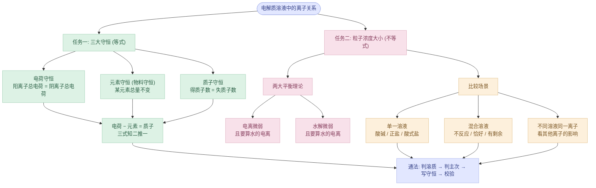
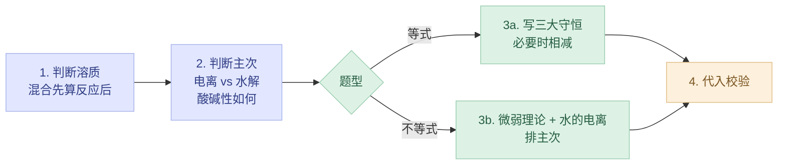

---
tags:
  - 化学/水溶液中的离子平衡
  - 化学/无机化学
  - 高中/选必一
date: 2026-10-27
---

# 专题：电解质溶液中的守恒关系与粒子浓度比较

> [!abstract] 一句话本质
> 溶液里的粒子再怎么电离、水解、变形，**"账"永远是平的**：
> **电荷守恒**（溶液不带电）｜**元素守恒**（原子不凭空增减）｜**质子守恒**（$\ce{H+}$ 有得必有失）。
> 守恒式解决**"等式题"**；两大平衡理论（电离、水解都"微弱"）解决**"不等式题"**。

---

## 零、纵向主线（先看这张图再往下读）

---

## 一、三大守恒

### 1.1 电荷守恒

> [!info] 标准表述
> 电解质溶液呈**电中性**：**阴离子所带负电荷总数 = 阳离子所带正电荷总数**。

**写法三步：**
1. 列出溶液中**实际存在的所有离子**（别漏 $\ce{H+}$、$\ce{OH-}$，水一直在电离）
2. 阳离子写一边，阴离子写另一边
3. **每个离子前面的系数 = 它所带的电荷数**（$\ce{CO3^2-}$ 前写 2）

| 溶液 | 电荷守恒式 |
|---|---|
| $\ce{NaHCO3}$ | $c(\ce{Na+})+c(\ce{H+})=c(\ce{HCO3-})+2c(\ce{CO3^2-})+c(\ce{OH-})$ |
| $\ce{Na2CO3}$ | $c(\ce{Na+})+c(\ce{H+})=2c(\ce{CO3^2-})+c(\ce{HCO3-})+c(\ce{OH-})$ |
| $\ce{CH3COONa}$ | $c(\ce{Na+})+c(\ce{H+})=c(\ce{CH3COO-})+c(\ce{OH-})$ |
| $\ce{NH4Cl}$ | $c(\ce{NH4+})+c(\ce{H+})=c(\ce{Cl-})+c(\ce{OH-})$ |
| $\ce{Na3PO4}$ | $c(\ce{Na+})+c(\ce{H+})=3c(\ce{PO4^3-})+2c(\ce{HPO4^2-})+c(\ce{H2PO4-})+c(\ce{OH-})$ |

> [!tip] 电荷守恒的三个特点
> - **与溶质是否水解、电离程度无关**，只要列全离子就一定成立
> - **只含离子**，不含分子（$\ce{H2CO3}$、$\ce{CH3COOH}$ 不出现）
> - 混合溶液照样成立，把所有离子一起列进去即可
>
> 验证一下（0.1 mol·L⁻¹ $\ce{Na2CO3}$，数值见 [[专题-盐类的水解]]）：
> $\ce{Na+}=0.2$；$\ce{CO3^2-}\approx0.0955$，$\ce{HCO3-}\approx\ce{OH-}\approx4.5\times10^{-3}$
> 右边 $=2\times0.0955+0.0045+0.0045=0.2$ ✔️

---

### 1.2 元素守恒（物料守恒）

> [!info] 标准表述
> 溶液中某些离子发生水解或电离，**存在形式变了，但其所含的某种元素的总量不变**。

**本质**：$\ce{Na+}$ 不水解、不电离，来多少就是多少；碳元素只是在 $\ce{CO3^2-}$、$\ce{HCO3-}$、$\ce{H2CO3}$ 之间"换马甲"，总数不变。所以**不变的那个元素的总量 = 溶质按化学式推出来的比例**。

**(1) 单一元素守恒**

$1\ \text{mol}\ \ce{NH3}$ 通入水中：$n(\ce{NH3})+n(\ce{NH3.H2O})+n(\ce{NH4+})=1\ \text{mol}$（氮元素守恒）

**(2) 两元素守恒**（最常考）

$\ce{NaHCO3}$ 溶液中，$\ce{HCO3-}$ 既电离又水解：

$$\ce{HCO3- <=> H+ + CO3^2-}\qquad\ce{HCO3- + H2O <=> H2CO3 + OH-}$$

钠与碳**1 : 1**，所以：

$$c(\ce{Na+})=c(\ce{HCO3-})+c(\ce{CO3^2-})+c(\ce{H2CO3})$$

| 溶质 | Na : 目标元素 | 元素守恒式 |
|---|---|---|
| $\ce{NaHCO3}$ | 1 : 1（C） | $c(\ce{Na+})=c(\ce{HCO3-})+c(\ce{CO3^2-})+c(\ce{H2CO3})$ |
| $\ce{Na2CO3}$ | 2 : 1（C） | $c(\ce{Na+})=2\left[c(\ce{CO3^2-})+c(\ce{HCO3-})+c(\ce{H2CO3})\right]$ |
| $\ce{Na2S}$ | 2 : 1（S） | $c(\ce{Na+})=2\left[c(\ce{S^2-})+c(\ce{HS-})+c(\ce{H2S})\right]$ |
| $\ce{Na3PO4}$ | 3 : 1（P） | $c(\ce{Na+})=3\left[c(\ce{PO4^3-})+c(\ce{HPO4^2-})+c(\ce{H2PO4-})+c(\ce{H3PO4})\right]$ |
| $\ce{NH4Cl}$ | 1 : 1（N 与 Cl） | $c(\ce{Cl-})=c(\ce{NH4+})+c(\ce{NH3.H2O})$ |
| $\ce{CH3COONa}$ | 1 : 1 | $c(\ce{Na+})=c(\ce{CH3COO-})+c(\ce{CH3COOH})$ |

**(3) 混合溶液中的元素守恒**（先算混合后各自的浓度，再找比例）

> [!example] 等浓度的 $\ce{CH3COOH}$ 与 $\ce{CH3COONa}$ 混合
> 设混合后两者都是 $c$：钠有 $c$，醋酸根相关的碳骨架共 $2c$，所以
> $$2c(\ce{Na+})=c(\ce{CH3COO-})+c(\ce{CH3COOH})$$

> [!example] 等浓度的 $\ce{NaHCO3}$ 与 $\ce{Na2CO3}$ 混合（各 $c$）
> $\ce{Na}=1c+2c=3c$，$\ce{C}=1c+1c=2c$，所以
> $$2c(\ce{Na+})=3\left[c(\ce{CO3^2-})+c(\ce{HCO3-})+c(\ce{H2CO3})\right]$$

> [!warning] 元素守恒的坑
> - **系数别丢**：$\ce{Na2CO3}$ 的钠是碳的**2 倍**
> - **只含"分子 + 离子"的碳（或氮、硫）形式**，不含 $\ce{H+}$、$\ce{OH-}$
> - 混合溶液要**先考虑稀释**（体积变了，浓度也变了）

---

### 1.3 质子守恒

> [!info] 标准表述
> 电解质在水溶液中发生电离、水解等过程中，**得到的质子（$\ce{H+}$）数 = 失去的质子数**。

**基准粒子法**（教材那张图）：

1. 选**基准粒子**：溶质中参与反应的离子 + **$\ce{H2O}$**（水是必选的）
2. 画出它们**得质子**、**失质子**后的产物
3. **得质子产物的总浓度（按得几个质子乘几）= 失质子产物的总浓度（按失几个质子乘几）**

**以 $\ce{NaHCO3}$ 为例：**

| 得质子产物 | 基准粒子 | 失质子产物 |
|---|---|---|
| $\ce{H2CO3}$（$+\ce{H+}$，得 1 个） | $\ce{HCO3-}$ | $\ce{CO3^2-}$（$-\ce{H+}$，失 1 个） |
| $\ce{H3O+}$（即 $\ce{H+}$，得 1 个） | $\ce{H2O}$ | $\ce{OH-}$（$-\ce{H+}$，失 1 个） |

$$c(\ce{H+})+c(\ce{H2CO3})=c(\ce{OH-})+c(\ce{CO3^2-})$$

> [!tip] 常见溶质的质子守恒（建议默写）
> | 溶质 | 基准粒子 | 质子守恒式 |
> |---|---|---|
> | $\ce{NaHCO3}$ | $\ce{HCO3-}$、$\ce{H2O}$ | $c(\ce{H+})+c(\ce{H2CO3})=c(\ce{OH-})+c(\ce{CO3^2-})$ |
> | $\ce{Na2CO3}$ | $\ce{CO3^2-}$、$\ce{H2O}$ | $c(\ce{OH-})=c(\ce{H+})+c(\ce{HCO3-})+2c(\ce{H2CO3})$ |
> | $\ce{CH3COONa}$ | $\ce{CH3COO-}$、$\ce{H2O}$ | $c(\ce{OH-})=c(\ce{H+})+c(\ce{CH3COOH})$ |
> | $\ce{NH4Cl}$ | $\ce{NH4+}$、$\ce{H2O}$ | $c(\ce{H+})=c(\ce{OH-})+c(\ce{NH3.H2O})$ |
> | $\ce{Na2S}$ | $\ce{S^2-}$、$\ce{H2O}$ | $c(\ce{OH-})=c(\ce{H+})+c(\ce{HS-})+2c(\ce{H2S})$ |
>
> **注意系数**：$\ce{CO3^2-}\to\ce{H2CO3}$ 要得 **2 个**质子，所以 $\ce{H2CO3}$ 前乘 2。

**推导法（更稳，不容易错）：电荷守恒 − 元素守恒，消去金属离子**

> [!example] $\ce{Na2CO3}$ 的质子守恒推导
> 电荷：$c(\ce{Na+})+c(\ce{H+})=2c(\ce{CO3^2-})+c(\ce{HCO3-})+c(\ce{OH-})$ ①
> 元素：$c(\ce{Na+})=2c(\ce{CO3^2-})+2c(\ce{HCO3-})+2c(\ce{H2CO3})$ ②
> ② 代入 ①，消去 $\ce{Na+}$：
> $$c(\ce{OH-})=c(\ce{H+})+c(\ce{HCO3-})+2c(\ce{H2CO3})\ \checkmark$$

> [!example] 混合溶液的质子守恒只能用推导法
> 等浓度 $\ce{CH3COOH}$ + $\ce{CH3COONa}$：
> 电荷：$c(\ce{Na+})+c(\ce{H+})=c(\ce{CH3COO-})+c(\ce{OH-})$
> 元素：$2c(\ce{Na+})=c(\ce{CH3COO-})+c(\ce{CH3COOH})$
> 消去 $\ce{Na+}$：
> $$2c(\ce{H+})+c(\ce{CH3COOH})=2c(\ce{OH-})+c(\ce{CH3COO-})$$
> 这种混合体系里**没有单一的基准粒子**，硬套基准粒子法容易漏项。

> [!important] 质子守恒的"隐藏用法"
> 对 $\ce{NaHCO3}$：$c(\ce{H2CO3})-c(\ce{CO3^2-})=c(\ce{OH-})-c(\ce{H+})$
> 溶液显碱性（$\ce{OH-}>\ce{H+}$），所以 $c(\ce{H2CO3})>c(\ce{CO3^2-})$，**即水解 > 电离**。
> 教材里 $\ce{NaHCO3}$ 的排序 $c(\ce{HCO3-})>c(\ce{H2CO3})>c(\ce{CO3^2-})$ 就是这么来的。

---

### 1.4 三大守恒怎么选

> [!tip] 一眼判断等式属于哪种守恒
> | 等式里有什么 | 属于 |
> |---|---|
> | 有金属（或 $\ce{NH4+}$）离子 **+** $\ce{H+}$ **+** $\ce{OH-}$，系数带电荷数 | **电荷守恒** |
> | 有金属离子，**没有** $\ce{H+}$、$\ce{OH-}$ | **元素守恒** |
> | 有 $\ce{H+}$、$\ce{OH-}$，**没有**金属离子 | **质子守恒** |
>
> 都不像？大概率是**三式组合**得到的，把能用的式子写出来做加减。

---

## 二、两大平衡理论（不等式题的底层逻辑）

> [!abstract] 核心就一句
> **电离、水解都是"微弱"的**，所以主要的粒子浓度远大于次要的；但**水的电离永远要算上**（它让 $\ce{H+}$ 和 $\ce{OH-}$ 多出一点点）。

### 2.1 电离平衡理论（弱电解质）

| 情形 | 要点 | 浓度顺序 |
|---|---|---|
| 一元弱碱 $\ce{NH3.H2O}$ | 电离微弱，且水还电离出一份 $\ce{OH-}$ | $c(\ce{NH3.H2O})>c(\ce{OH-})>c(\ce{NH4+})$ |
| 多元弱酸 $\ce{H2S}$ | **分步电离，以第一步为主**（第一步远大于第二步） | $c(\ce{H2S})>c(\ce{H+})>c(\ce{HS-})>c(\ce{S^2-})$ |

> [!tip] 为什么 $\ce{NH3.H2O}$ 中 $c(\ce{OH-})>c(\ce{NH4+})$？
> $\ce{OH-}$ 有**两个来源**：氨水电离 + 水电离；$\ce{NH4+}$ 只有氨水电离这一个来源。
> 电荷守恒：$c(\ce{NH4+})+c(\ce{H+})=c(\ce{OH-})$，$\ce{H+}$ 虽小，也使 $\ce{OH-}$ 略大。

### 2.2 水解平衡理论（盐）

| 情形 | 要点 | 浓度顺序 |
|---|---|---|
| 强酸弱碱盐 $\ce{NH4Cl}$ | 水解微弱，$\ce{NH4+}$ 减少一点点 | $c(\ce{Cl-})>c(\ce{NH4+})>c(\ce{H+})>c(\ce{NH3.H2O})$ |
| 多元弱酸正盐 $\ce{Na2CO3}$ | **分步水解，水解程度逐级减弱** | $c(\ce{Na+})>c(\ce{CO3^2-})>c(\ce{OH-})>c(\ce{HCO3-})>c(\ce{H2CO3})$ |
| 酸式盐 $\ce{NaHA}$ | **先判断电离与水解谁占主导** | 见下表 |

> [!tip] 为什么 $\ce{NH4Cl}$ 中 $c(\ce{H+})>c(\ce{NH3.H2O})$？
> 质子守恒：$c(\ce{H+})=c(\ce{OH-})+c(\ce{NH3.H2O})$，所以 $\ce{H+}$ 一定**大于** $\ce{NH3.H2O}$。
> 同理 $\ce{Na2CO3}$ 中 $c(\ce{OH-})>c(\ce{HCO3-})$，因为 $c(\ce{OH-})=c(\ce{H+})+c(\ce{HCO3-})+2c(\ce{H2CO3})$。
> **质子守恒就是这些"水解产物 vs 水电离产物"大小的出处。**

**酸式盐（$\ce{NaHA}$）的两种情形：**

| 主导过程 | 代表 | 浓度顺序 |
|---|---|---|
| **电离为主**（溶液显酸性） | $\ce{NaHSO3}$、$\ce{NaH2PO4}$ | $c(\ce{Na+})>c(\ce{HA-})>c(\ce{H+})>c(\ce{A^2-})>c(\ce{H2A})$ |
| **水解为主**（溶液显碱性） | $\ce{NaHCO3}$、$\ce{NaHS}$、$\ce{Na2HPO4}$ | $c(\ce{Na+})>c(\ce{HA-})>c(\ce{OH-})>c(\ce{H2A})>c(\ce{A^2-})$ |

> [!warning] 注意 $\ce{NaHCO3}$ 的完整顺序
> 教材给的是 $c(\ce{Na+})>c(\ce{HCO3-})>c(\ce{H2CO3})>c(\ce{CO3^2-})$（四个主要粒子）。
> 若把 $\ce{OH-}$、$\ce{H+}$ 也算进去（0.1 mol·L⁻¹，pH $\approx$ 8.3）：
> $$c(\ce{Na+})>c(\ce{HCO3-})>c(\ce{H2CO3})>c(\ce{CO3^2-})>c(\ce{OH-})>c(\ce{H+})$$
> $\ce{H2CO3}$ 和 $\ce{CO3^2-}$ 大小很接近（约 $10^{-3}$），差值恰好等于 $c(\ce{OH-})-c(\ce{H+})$，这就是上面质子守恒的结论。

---

## 三、粒子浓度大小比较（题型主线）

### 3.1 单一溶液

> [!important] 三类溶液三套思路
> 1. **酸、碱溶液**：$\ce{H+}$ 或 $\ce{OH-}$ 浓度最大，其余粒子按电离程度比较
> 2. **正盐溶液**：考虑离子的**水解**
> 3. **酸式盐溶液**：先判断酸式酸根是**电离为主**还是**水解为主**，再比较

> [!example] $\ce{CH3COONa}$ 溶液
> $$c(\ce{Na+})>c(\ce{CH3COO-})>c(\ce{OH-})>c(\ce{CH3COOH})>c(\ce{H+})$$
> $\ce{OH-}>\ce{CH3COOH}$ 来自质子守恒：$c(\ce{OH-})=c(\ce{H+})+c(\ce{CH3COOH})$。

### 3.2 混合溶液

> [!abstract] 总原则
> 根据**电离程度、水解程度的相对大小**综合分析，先写出混合后的**溶质组成**。

**① 两种物质混合不反应**（弱电解质 + 其盐，等浓度）

| 情形 | 例子 | 酸碱性 | 浓度顺序 |
|---|---|---|---|
| **a. 电离 > 水解** | $0.1\ \text{mol·L}^{-1}$ $\ce{CH3COOH}$ + $0.1\ \text{mol·L}^{-1}$ $\ce{CH3COONa}$ | 酸性 | $c(\ce{CH3COO-})>c(\ce{Na+})>c(\ce{CH3COOH})>c(\ce{H+})>c(\ce{OH-})$ |
| **b. 电离 < 水解** | $0.1\ \text{mol·L}^{-1}$ $\ce{HCN}$ + $0.1\ \text{mol·L}^{-1}$ $\ce{NaCN}$ | 碱性 | $c(\ce{HCN})>c(\ce{Na+})>c(\ce{CN-})>c(\ce{OH-})>c(\ce{H+})$ |

> [!tip] 用守恒把顺序"证"出来
> **a 型**：电荷守恒 $c(\ce{CH3COO-})=c(\ce{Na+})+c(\ce{H+})-c(\ce{OH-})$，酸性 $\ce{H+}>\ce{OH-}$ → $c(\ce{CH3COO-})>c(\ce{Na+})$。
> **b 型**：元素守恒 $c(\ce{HCN})+c(\ce{CN-})=2c(\ce{Na+})$，碱性说明 $\ce{CN-}$ 被水解掉得多 → $c(\ce{HCN})>c(\ce{Na+})>c(\ce{CN-})$（教材里 $c(\ce{Na+})=0.1$ 是这个意思）。

> [!important] 等浓度一元弱酸 + 其钠盐，怎么判酸碱性？
> 比较 $K_a$ 与 $K_h=K_w/K_a$：电离 > 水解 $\iff K_a>K_h\iff K_a>10^{-7}$。
> | 混合体系 | $K_a$ | 结果 |
> |---|---|---|
> | $\ce{CH3COOH}$ / $\ce{CH3COONa}$ | $1.8\times10^{-5}$ | 酸性（电离为主） |
> | $\ce{HF}$ / $\ce{NaF}$ | $\approx6\times10^{-4}$ | 酸性 |
> | $\ce{HCN}$ / $\ce{NaCN}$ | $\approx6\times10^{-10}$ | 碱性（水解为主） |
> | $\ce{HClO}$ / $\ce{NaClO}$ | $\approx4\times10^{-8}$ | 碱性 |
> | $\ce{NH3.H2O}$ / $\ce{NH4Cl}$（弱碱同理，看 $K_b$） | $K_b=1.8\times10^{-5}$ | 碱性（电离为主） |

**② 两种物质恰好完全反应**

> [!example] $100\ \text{mL}\ 0.1\ \text{mol·L}^{-1}$ $\ce{CH3COOH}$ + $50\ \text{mL}\ 0.2\ \text{mol·L}^{-1}$ $\ce{NaOH}$
> $n=10\ \text{mmol}$ 对 $10\ \text{mmol}$，恰好得 $\ce{CH3COONa}$ 溶液：
> $$c(\ce{Na+})>c(\ce{CH3COO-})>c(\ce{OH-})>c(\ce{H+})$$
> 完全回到 3.1 的单一溶液问题。

**③ 两种物质反应，其中一种有剩余**

> [!example] $10\ \text{mL}\ 0.1\ \text{mol·L}^{-1}$ $\ce{CH3COOH}$ + $10\ \text{mL}\ 0.2\ \text{mol·L}^{-1}$ $\ce{NaOH}$
> 酸 $1\ \text{mmol}$，碱 $2\ \text{mmol}$ → 剩 $1\ \text{mmol}$ $\ce{NaOH}$ + 生成 $1\ \text{mmol}$ $\ce{CH3COONa}$
> 溶质为**等浓度的 $\ce{CH3COONa}$、$\ce{NaOH}$**：
> $$c(\ce{Na+})>c(\ce{OH-})>c(\ce{CH3COO-})>c(\ce{H+})$$
> 理由：$\ce{NaOH}$ 完全电离，$\ce{OH-}$ 本就约等于 $\ce{CH3COO-}$ 的量，再加上 $\ce{CH3COO-}$ 水解又产生 $\ce{OH-}$、消耗 $\ce{CH3COO-}$，所以 $\ce{OH-}>\ce{CH3COO-}$。

> [!tip] 有剩余时的通法
> **写出反应后的溶质 → 把"弱酸 + 其盐"、"弱碱 + 其盐"识别出来 → 套用 ① 的 a、b 判断；若剩的是强酸强碱，直接抑制水解（$\ce{H+}$/$\ce{OH-}$ 最大）。**

### 3.3 不同溶液中同一离子浓度的比较

> [!important] 看"其他离子"的影响
> - **相互促进水解**的离子 → 目标离子浓度**减小**
> - **抑制**目标离子水解的离子 → 目标离子浓度**增大**
> - 要比较的离子本身的**物质的量系数**（如 $(\ce{NH4})_2\ce{SO4}$ 含两个 $\ce{NH4+}$）也要算

> [!example] 教材例：相同浓度的 ① $\ce{Na2CO3}$、② $(\ce{NH4})_2\ce{CO3}$ 中 $c(\ce{CO3^2-})$
> ① > ②：$\ce{NH4+}$ 与 $\ce{CO3^2-}$ **相互促进水解**，$(\ce{NH4})_2\ce{CO3}$ 中 $\ce{CO3^2-}$ 损耗更多。

> [!example] 同浓度（0.1 mol·L⁻¹）下 $c(\ce{NH4+})$ 排序
> ① $(\ce{NH4})_2\ce{SO4}$ ② $\ce{NH4HSO4}$ ③ $\ce{NH4Cl}$ ④ $\ce{CH3COONH4}$ ⑤ $\ce{NH4HCO3}$ ⑥ $\ce{NH3.H2O}$
> $$\text{①}>\text{②}>\text{③}>\text{④}>\text{⑤}>\text{⑥}$$
> - ① 一个单位含 **2 个** $\ce{NH4+}$，最大
> - ② $\ce{NH4HSO4}$ 电离出 $\ce{H+}$，**抑制** $\ce{NH4+}$ 水解 → 比 ③ 大
> - ④⑤ 阴离子水解产生 $\ce{OH-}$，**促进** $\ce{NH4+}$ 水解；$\ce{HCO3-}$ 水解比 $\ce{CH3COO-}$ 强，所以 ⑤ < ④
> - ⑥ 弱碱电离，产生的 $\ce{NH4+}$ 最少

---

## 四、解题通法

| 步骤 | 做什么 | 常见失误 |
|---|---|---|
| 判溶质 | 弄清有哪些溶质、各自浓度（混合要先算稀释） | 忘了稀释；漏了剩余的酸或碱 |
| 判主次 | 电离与水解谁强，溶液酸还是碱 | 凭感觉不看 $K_a$、$K_b$ |
| 写守恒 | 电荷、元素各写一遍，必要时相减得质子守恒 | 漏系数；漏 $\ce{H+}$/$\ce{OH-}$ |
| 排顺序 | 大量粒子 → 微弱产物 → 水电离产物 | 把水解产物写得比水电离产物还小，或反过来 |
| 校验 | 把守恒式和结论代回去 | 排序与守恒矛盾而不自知 |

---

## 五、综合例题

> [!example] 例 1：写出 $\ce{Na2S}$ 溶液的三大守恒
> - 电荷：$c(\ce{Na+})+c(\ce{H+})=2c(\ce{S^2-})+c(\ce{HS-})+c(\ce{OH-})$
> - 元素：$c(\ce{Na+})=2\left[c(\ce{S^2-})+c(\ce{HS-})+c(\ce{H2S})\right]$
> - 质子：$c(\ce{OH-})=c(\ce{H+})+c(\ce{HS-})+2c(\ce{H2S})$
> - 浓度顺序：$c(\ce{Na+})>c(\ce{S^2-})>c(\ce{OH-})>c(\ce{HS-})>c(\ce{H2S})>c(\ce{H+})$

> [!example] 例 2：写出 $\ce{NH4Cl}$ 溶液的三大守恒
> - 电荷：$c(\ce{NH4+})+c(\ce{H+})=c(\ce{Cl-})+c(\ce{OH-})$
> - 元素：$c(\ce{Cl-})=c(\ce{NH4+})+c(\ce{NH3.H2O})$
> - 质子：$c(\ce{H+})=c(\ce{OH-})+c(\ce{NH3.H2O})$

> [!example] 例 3：$0.1\ \text{mol·L}^{-1}$ $\ce{NaHCO3}$，下列正确的是？
> A. $c(\ce{Na+})=c(\ce{HCO3-})+c(\ce{CO3^2-})$
> B. $c(\ce{Na+})+c(\ce{H+})=c(\ce{HCO3-})+c(\ce{CO3^2-})+c(\ce{OH-})$
> C. $c(\ce{OH-})=c(\ce{H+})+c(\ce{H2CO3})-c(\ce{CO3^2-})$
>
> **答：只有 C 对。**
> A 漏了 $\ce{H2CO3}$；B 的 $\ce{CO3^2-}$ 前漏了系数 2；C 由质子守恒移项得到 ✔️

> [!example] 例 4：等浓度 $\ce{CH3COOH}$ 与 $\ce{CH3COONa}$ 等体积混合，判断 $c(\ce{CH3COO-})+2c(\ce{OH-})$ 与 $c(\ce{CH3COOH})+2c(\ce{H+})$ 的大小
> 由前面的推导：$2c(\ce{H+})+c(\ce{CH3COOH})=2c(\ce{OH-})+c(\ce{CH3COO-})$，**二者相等**。

---

## 六、易错清单（考前五分钟只看这个）

> [!danger] 十二个高频错点
> - [ ] 电荷守恒里 $\ce{CO3^2-}$、$\ce{SO4^2-}$、$\ce{PO4^3-}$ **忘记乘电荷数**
> - [ ] 电荷守恒漏掉 $\ce{H+}$ 或 $\ce{OH-}$
> - [ ] 电荷守恒式里写进了**分子**（$\ce{H2CO3}$、$\ce{CH3COOH}$）
> - [ ] 元素守恒 $\ce{Na2CO3}$ 忘记钠是碳的**2 倍**
> - [ ] 元素守恒里出现 $\ce{H+}$、$\ce{OH-}$（**错**，只含目标元素的各种形态）
> - [ ] 质子守恒忘了**把水当基准粒子**
> - [ ] $\ce{CO3^2-}\to\ce{H2CO3}$ 要得 **2 个**质子，系数写成 1
> - [ ] **混合溶液**硬套基准粒子法（应改用电荷 − 元素相减）
> - [ ] 混合后忘了**体积变大、浓度变小**
> - [ ] $\ce{NaHA}$ 不判电离与水解孰强就直接排序
> - [ ] 误认为"弱酸 + 其盐"混合一定显酸性（$\ce{HCN}$/$\ce{NaCN}$、$\ce{HClO}$/$\ce{NaClO}$ 显碱性）
> - [ ] 排序时把"水解产物"排在"水电离产物"后面（如 $\ce{Na2CO3}$ 中 $\ce{OH-}>\ce{HCO3-}$，由质子守恒保证）

---

## 七、一页总结（Callout 速记卡）

> [!abstract] 三大守恒 · 核心
> **电荷**：阳离子电荷总数 = 阴离子电荷总数，**系数 = 电荷数**，只含离子。
> **元素**：某元素总量不变，由化学式比例定，只含该元素的各形态。
> **质子**：得质子数 = 失质子数；基准粒子必含 $\ce{H2O}$；**质子 = 电荷 − 元素**。

> [!info] 两大平衡理论
> 电离微弱、水解微弱，**都要加上水的电离**。
> 多元弱酸分步电离（第一步为主），多元弱酸根分步水解（第一步为主）。

> [!tip] 比较大小的五个场景
> 酸碱溶液 ｜ 正盐溶液 ｜ 酸式盐（先判电离/水解） ｜ 混合溶液（不反应、恰好、有剩余） ｜ 不同溶液同一离子（看其他离子的促进或抑制）

> [!warning] 判断题的"等式"检索
> 有金属离子 + $\ce{H+}$ + $\ce{OH-}$ → 电荷｜有金属离子、无 $\ce{H+}$/$\ce{OH-}$ → 元素｜有 $\ce{H+}$/$\ce{OH-}$、无金属离子 → 质子。

---

> [!quote] 一句话打通全章
> **溶液不带电（电荷）、原子不消失（元素）、质子有得有失（质子），三本账互相推得出；而离子比大小，就是"主要的大、微弱的小、别忘了水"。**

---

## 八、相关笔记

- [[专题-盐类的水解]] — 守恒和排序的物理基础：水解的方程式、$K_h$、双水解
- [[专题-燃料电池]] — 电荷守恒在电极反应配平中的应用
- [[常见有机物总结]] — 弱酸（羧酸）、弱碱（胺）的电离与水解
