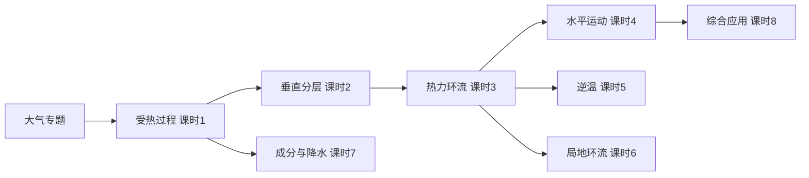

---
tags:
  - 地理/自然地理
  - 高中/大气
  - MOC
date: 2026-10-05
---

# 大气专题总纲（MOC）

> [!info] 学习主线
> 整个「大气」专题沿着一条因果链展开：
> **受热不均 → 垂直运动 → 水平气压差 → 风 → 环流 → 天气现象**

## 📚 课时索引

| 课时 | 主题 | 核心问题 |
|------|------|----------|
| [[课时1-大气的受热过程]] | 大气的受热过程 | 削弱作用与保温作用如何实现？ |
| [[课时2-大气的垂直分层]] | 大气的垂直分层 | 分几层？各层气温怎么变？ |
| [[课时3-热力环流原理与等压面判读]] | 热力环流 | 冷热不均如何产生风？ |
| [[课时4-大气水平运动与风向判读]] | 大气的水平运动 | 高空风、近地面风怎么判？ |
| [[课时5-逆温现象及其影响]] | 逆温现象 | 逆温为何抑制对流？有何影响？ |
| [[课时6-局地环流]] | 局地环流 | 海陆风、山谷风、热岛环流 |
| [[课时7-大气成分与降水]] | 大气成分、气溶胶与降水 | 气溶胶的双重作用？ |
| [[课时8-综合应用与答题模板]] | 综合应用 | 热岛强度、区域气候分析 |

## 🧭 方法论

- [[地理通用方法论]] —— 三层结构模型 / 五因模型 / 三比较法
- [[必修一总述]] / [[必修二总述]] —— 湘教版教材全书复习

## 🗂️ 记忆地图

