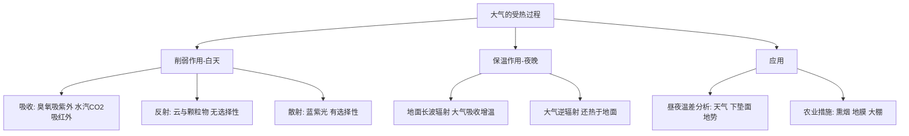

---
tags:
  - 地理/大气
  - 高中
date: 2026-10-05
---

# 专题：大气的受热过程（削弱作用与保温作用）

> [!info] 核心原理
> - 能量链条：**太阳短波辐射 → 地面吸收（地面增温）→ 地面长波辐射 → 大气吸收（大气增温）→ 大气逆辐射（还热于地面）**
> - 两个关键结论：
>   - **近地面大气的直接热源是地面辐射**（不是太阳辐射！）
>   - **大气的两个作用 = 白天削弱、夜晚保温**，是解释所有气温、温差问题的总钥匙
> - 高频考法：昼夜温差大小、农业措施的天气学原理、云量对气温的影响、青藏高原"太阳辐射强而气温低"

## 一、受热过程的三个环节

| 环节 | 过程 | 原理与选择性 | 结果 |
|------|------|--------------|------|
| ① 太阳辐射到达地面 | 大气对太阳短波辐射的**削弱作用** | **吸收**（臭氧吸紫外、水汽和CO₂吸红外，有明显选择性）；**反射**（云层、颗粒物，无选择性）；**散射**（蓝紫光易散射，有选择性） | 削弱作用越强，**白天气温越低** |
| ② 地面吸收后增温并辐射 | 地面长波辐射（大部分被水汽、CO₂吸收） | 大气吸收地面长波辐射而增温 → **气温随高度升高而降低** | 对流层的直接热源是**地面** |
| ③ 大气逆辐射 | 大气辐射中射向地面的部分 | 云量多、水汽多、CO₂多 → 大气逆辐射强 | 逆辐射越强，**夜晚气温越高（保温强）** |

> [!tip] 一句话口诀
> **白天看削弱，夜晚看保温；云多削弱强、保温强 → 昼夜温差小。**

## 二、昼夜温差分析（通用答题维度）

| 角度 | 具体思路 | 温差 |
|------|----------|------|
| **天气状况** | 多晴朗天气 | 白天削弱弱、夜晚保温弱 | **温差大** |
| | 多阴雨天气 | 白天削弱强、夜晚保温强 | **温差小** |
| **下垫面** | 水域面积大 | 比热容大，增温与降温都慢 | **温差小** |
| | 陆地面面积大 | 比热容小，增温与降温都快 | **温差大** |
| **地势** | 山峰等凸地 | 海拔高、白天热量易散失、气温低；空气易下沉，但受地面降温影响小，夜晚温度变化小 | **温差小** |
| | 盆地等凹地 | 地形相对封闭，白天热量易聚集；夜晚冷空气下沉且受地面冷却影响 | **温差大** |
| **其他** | 植被覆盖率、积雪覆盖、湖泊/城市热岛 | 植被、积雪、水体→温差小；裸地、城市建成区→温差大 | — |

## 三、受热过程原理的应用

| 现象 / 措施 | 原理 |
|-------------|------|
| 农田**熏烟防霜冻** | 烟雾增强**大气逆辐射**，保温作用增强 |
| **地膜覆盖** | 减少地面长波辐射散失（阻隔地面与大气热量交换），起到保温保湿作用 |
| **温室大棚** | 玻璃/薄膜让太阳短波进入、阻挡地面长波散失 |
| **青藏高原**太阳辐射强、气温低 | 空气稀薄 → 削弱作用**弱**（辐射强），保温作用**弱**（气温低） |
| 云雨天气近地面气温较低（A卷第17题） | 云雨**削弱太阳辐射**，到达地面的热量减少 |
| 沙尘气溶胶（A卷第10题） | 吸收**地面辐射**使大气增温；作为**凝结核**促进云的发展；对太阳辐射的反射/散射增强会使大气散热，**不利于**加热深积云 |
| 塔里木盆地沙尘多但降水少（A卷第11题） | 沙尘气溶胶主要来自**干旱半干旱区**，水汽条件差，不利于降水 |

> [!example] 例题 1（对应 A卷第17题）
> 某日 16—18 时山地未形成上山气流，且附近有云雨层，分析原因。
>
> **答**：云雨**削弱太阳辐射**，使山坡地面温度较低，山坡与谷底温差小，**难以形成上升气流（谷风）**，故未形成上山气流。

> [!example] 例题 2（对应 A卷第21题第3问）
> 8 月降水较 1 月多，分析其对当地气温（昼夜温差）的影响。
>
> **答**：8 月降水多、**云层较厚**，白天云层对太阳辐射的**削弱作用强**，气温较低；夜晚大气逆辐射强、**保温作用好**，气温较高 → **昼夜温差较小**。同时 8 月气温高、冰雪融水多、湖泊面积大，湖泊对气温的**调节作用强**，也使温差变小。

## 四、常见易错点

> [!warning] 易错警示
> - **近地面大气的直接热源是地面辐射**，文字表述别写成"太阳辐射"
> - 反射**无选择性**（云层、颗粒物），散射**有选择性**（蓝紫光），吸收也**有选择性**
> - "削弱作用强 → 白天气温低"，"保温作用强 → 夜晚气温高"，两者**方向相反**，切勿混用
> - 只有"大气逆辐射"才对地面有保温作用，大气向上射向宇宙空间的长波辐射是**散热**
> - 分析温差题必须写全"白天＋夜晚"两个方向，只写一方会丢分

## 五、思维导图

