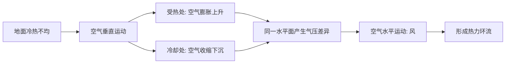
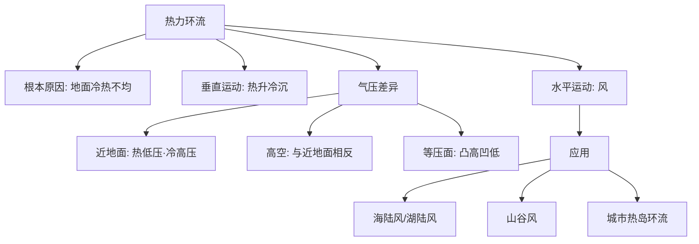

---
tags:
  - 地理/自然地理
  - 高中/大气
date: 2026-10-05
---

# 课时 3：热力环流原理与等压面判读

> [!info] 核心原理
> - 根本原因：**地面冷热不均**（太阳辐射的纬度/下垫面差异）
> - 形成顺序：**冷热不均 → 垂直运动 → 同一水平面气压差异 → 水平运动（风）**
> - 三句口诀：**热上升冷下沉；近地面与高空气压性质相反；等压面凸高凹低**

## 一、形成过程

## 二、等压线与等压面

| 概念 | 定义 |
|---|---|
| **等压线** | 同一高度上气压相等的各点连成的（闭合）曲线 |
| **等压面** | 空间气压相等的各点组成的面 |

**两条硬规则**：
1. **垂直方向**：近地面气压总是高于高空（同一地点，气压随高度递减）
2. **同一水平面**：等压面**向上凸**处为**高压**，**向下凹**处为**低压**（"凸高凹低"）；近地面与高空气压性质**相反**

## 三、气压高低判读五步法（A 卷第 13 题标注整理）

> [!example] 例题（冬季室内外等压面判读）
> **步骤**：
> 1. 明确概念：等压线是同一高度气压相等各点的连线；等压面是空间气压相等各点组成的面
> 2. **垂直比较**：近地面气压高于高空（图中的等压面数值自下而上减小：1000 → 1005 → 1010 → 1015 hPa）
> 3. **近地面比较**：根据地面冷热状况判断——**热低压、冷高压**。B 处（冷）气压大于 A 处（热）
> 4. **高空比较**：同一水平面用"凸高凹低"。C 处等压面**上凸** → C 处为**高压**；D 处等压面**下凹** → D 处为**低压**
> 5. 汇总：**B ＞ A ＞ C ＞ D**

**判读顺序小结**：先定"哪一侧冷、哪一侧热" → 再定近地面气压（冷高压、热低压）→ 高空用"凸高凹低" → 最后把四个点串起来比较。

> [!example] 例题（A 卷第 12 题·门帘飘动）
> 冬季东北地区室内外温差大，门口门帘飘动，体现的原理。
>
> **解**：属于**热力环流**。冬季室内暖 → 空气上升 → 室内近地面形成**低压**；室外冷 → 空气下沉 → 室外近地面形成**高压**；近地面气流由**室外流向室内**，故门帘被压向室内。
> 原理链条：温差 → 垂直运动 → 水平气压差 → 水平运动。

## 四、常见易错点

> [!warning] 易错警示
> - "热的地方气压低"只对**近地面**成立；**高空**恰好相反（受热处高空为高压）
> - 判断气压高低必须先**锁定同一水平面**，不能把近地面与高空直接比较大小
> - 等压面弯曲的判读："**凸高为高、凹低为低**"，别记成"凸起就是低压"
> - 风力大小看**等压线疏密**，不看温度高低（见课时 4）
> - 热力环流是**水平气压梯度力**驱动的结果，垂直运动只是"前提条件"

## 五、思维导图

> [!tip] 自测
> 1. 画一幅"城市—郊区"环流示意图，标出近地面与高空的等压面弯曲方向。
> 2. 若 A 地近地面气压高于 B 地，则 A、B 两地的高空气压谁高？为什么？