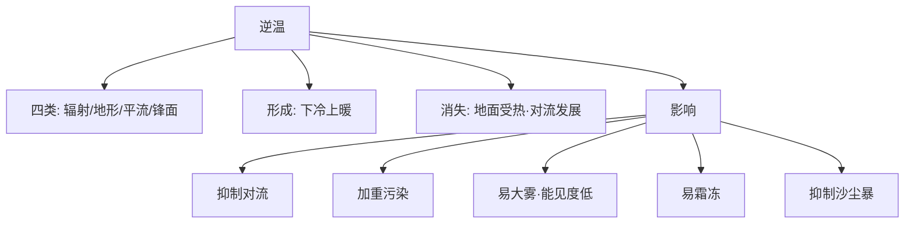

---
tags:
  - 地理/自然地理
  - 高中/大气
date: 2026-10-05
---

# 课时 5：逆温现象及其影响

> [!info] 核心原理
> - **定义**：在对流层中，气温本应随高度升高而降低；若出现**气温随高度升高而升高**（或降温幅度明显减小）的现象，称为逆温
> - 逆温 = 大气层结**稳定**（上暖下冷），**抑制对流** → "稳定"是理解一切影响的钥匙
> - 逆温的**形成**靠"下冷上暖"，逆温的**消失**靠"地面受热、对流发展"

## 一、四类逆温对比

| 类型 | 形成条件 | 出现时间 / 地区 | 伴随现象 |
|---|---|---|---|
| **辐射逆温** | 晴朗无云的夜晚，**近地面大气降温快**，高处降温慢 | 中高纬度**大陆**地区，**日出前后最强** | 霜冻、晨雾、空气污染加重 |
| **地形逆温** | 山坡散热快，**冷空气沿山坡下沉到谷底**，谷底原来暖空气被抬升 | 夜间**山谷** | 常伴随**夜雨**，谷底多雾、易霜冻 |
| **平流逆温** | 暖空气水平流动到**冷的地面或水面**上，近地面空气接触冷却更快 | 冬季中纬度**沿海**地区 | 常伴随**海雾** |
| **锋面逆温** | **锋面之上**的暖空气与下面的冷空气形成"上暖下冷" | 锋面附近 | 锋面云系、锋面降水 |

## 二、逆温的生消过程（辐射逆温为例）

- **日落前后**：地面辐射冷却加强，近地面先降温 → 逆温自下而上形成
- **日出前后**：地面散热达到最强 → 逆温**最厚、最强**
- **日出后**：太阳辐射增强，地面增温 → 对流发展 → 逆温自下而上**逐渐消失**（打破稳定层结）

## 三、逆温的影响（四条必背）

1. **空气对流运动弱**（抑制对流），大气污染物不易扩散 → **加重大气污染**
2. 但同时可**抑制沙尘暴、扬尘**等发生（近地面大风与强对流被抑制）
3. **易出现大雾**，降低大气能见度（影响交通、航空）
4. **易出现霜冻**（冷空气下沉聚集、近地面气温低）

> [!example] 例题 1（A 卷第 7 题·天气现象成因）
> 判断关于稳定层结、强对流天气、城市热岛夜雨、逆温等说法的正误。
>
> **解**（逐项）：
> - 稳定的大气层结指**空气的垂直运动受到抑制**的状态；受热不均、层结不稳定引起上升运动形成**积状云** → 正确
> - 龙卷风、雷暴属于**强对流天气**，大气层结**不稳定**（不是稳定）→ 说法错
> - 城市热岛效应**多发于夜晚**：夜晚地面因地面辐射而失去热量，近地面大气冷却强烈，较高处大气冷却较慢，形成**逆温**，大气层结稳定 → 正确

> [!example] 例题 2（A 卷第 16 题·山谷风与逆温）
> 由图 a 可知 7—9 时山谷南北坡同时存在上升和下降气流，判断逆温消失的大致时间。
>
> **解**：
> - 逆温现象常出现在**夜晚或日出前**：山坡冷却快，冷空气沿山坡下沉至谷底，谷底气温较低、上方空气较暖 → 形成**地形（山谷）逆温**
> - 逆温**消失需要地面加热**，使谷底气温上升，打破稳定层结
> - 图 a 中 7—9 时南北坡**同时存在上升和下降气流**，说明正处于**山谷风转换**阶段，逆温仍存在
> - 10—15 时太阳辐射增强、地面加热明显，**谷风发展强盛**（气流由谷底沿山坡上升），此时逆温应**完全消失**
> - 结合选项：6 时可能仍处于逆温最强时段（日出前）；17 时开始出现逆温；**推测消失时间约 10 时**

> [!example] 例题 3（A 卷第 9 题·对流与稳定度）
> 若背景风（盛行风）较弱，白天气温升高后近地面比湿如何变化？为什么？
>
> **解**：气温升高 → **对流运动增强** → 近地面水汽被输送到高层 → 近地面**比湿减小**，午后达极小值；太阳辐射减弱后对流减弱，比湿回升。
> 反过来说：**逆温抑制对流**时，近地面水汽不易向上输送，近地面比湿反而偏高。

## 四、常见易错点

> [!warning] 易错警示
> - 逆温 ≠ 平流层"上热下冷"：逆温特指**对流层内**的异常现象
> - 逆温**强度最大的是日出前后**（不是午夜），因为地面整夜持续辐射冷却
> - 逆温影响"**有弊也有利**"：加重大气污染是弊；抑制沙尘暴、扬尘是利，不能只答一面
> - 山谷夜里易"**夜雨**"与谷底"**多雾**"看似矛盾，实际：谷底暖空气被抬升成云致雨（发生于谷底上方），而近地面因冷空气堆积多雾
> - 判读逆温是否消失，看**气流方向**（谷底→山坡上升为谷风）与**地面是否增温**

## 五、思维导图

> [!tip] 自测
> 1. 为什么四川盆地冬季多雾、空气质量偏差？
> 2. 用气温垂直变化曲线说明"日出前逆温最强、上午逐渐消失"的过程。