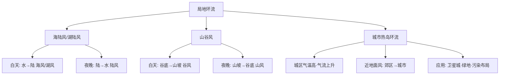

---
tags:
  - 地理/自然地理
  - 高中/大气
date: 2026-10-05
---

# 课时 6：局地环流（海陆风 · 湖陆风 · 山谷风 · 城市热岛环流）

> [!info] 核心原理
> - 一切局地环流都源于**下垫面热力性质差异**（比热容不同）→ 昼夜温差 → 热力环流
> - **陆风/海风记忆法**："**白天风从水面吹向陆地（海风、湖风），夜晚风从陆地吹向水面（陆风）**"
> - 判读三步：**定水体方位 → 判昼夜（谁热谁冷）→ 定风向与气流**

## 一、四类局地环流对比

| 类型 | 成因 | 白天 | 夜晚 |
|---|---|---|---|
| **海陆风** | 海陆比热容差异 | **海风**（海→陆） | **陆风**（陆→海） |
| **湖陆风** | 湖泊与陆地比热容差异（内陆湖泊更明显） | **湖风**（湖→陆） | **陆风**（陆→湖） |
| **山谷风** | 山坡与谷底受热/散热差异 | **谷风**（谷底→山坡） | **山风**（山坡→谷底） |
| **城市热岛环流** | 城市气温高于郊区（人类活动释放废热、下垫面、绿地少） | 近地面风由**郊区吹向城市**（全天如此） | 同左，夜晚更明显 |

## 二、湖陆风判读（A 卷第 18、19 题整理）

> [!example] 例题 1（A 卷第 18 题·表格逐项辨析）
> 某气象观测点测得的湖陆风资料，判断各项说法。
>
> **解**（逐项）：
> - 湖风（东南风或偏东风）风速**大于**陆风（西南风），且持续时间更长 → 正确
> - 21 时至次日 6 时吹**陆风**（西南风），6—8 时西南风转东南风 → 即**陆风转湖风** → 正确
> - 图中显示该湖岸区域 8—19 时吹**湖风**（东南风或偏东风），19—21 时东南风逐渐转偏南风，即**湖风转陆风**（"8—19 时吹湖风，19—21 时由东南风转偏南风"说明风向在 19 时后转变）→ 需按时间轴核对，**D 项说法与图示不符**

> [!example] 例题 2（A 卷第 19 题·由风向判断相对位置）
> 该气象观测点 21 时至次日 6 时吹陆风为**西南风**，湖风为**东南风或偏东风**，问观测点位于湖泊的哪一侧？
>
> **解**：
> - 陆风：**陆地 → 湖泊**，风向为西南风 → 陆地在其西南方
> - 湖风：**湖泊 → 陆地**，风向为东南风/偏东风 → 湖泊在其东（东南）方
> - 结论：**观测点位于湖泊西侧**（风向在 7 时左右发生明显变化，说明水陆热力差异发生转换）

## 三、湖陆风对城市建成区的影响（A 卷第 20 题）

> [!example] 例题
> 判断湖陆风对城市建成区影响的说法（正确项：白天湖风从湖泊吹向周围城市建成区，有明显降温效果，可缓解城市热岛效应）。
>
> **解**：
> - 白天湖泊升温慢（水温低）→ 湖面气压相对较高，**湖风从湖泊吹向周围城市建成区**，带来**降温、增湿**效果，**缓解城市热岛效应** → 正确
> - 夜晚陆地降温快，**陆风从城市建成区吹向湖泊**，会把城市热量/污染物带向湖区；"湖泊受人类活动影响小、空气质量较好"不能推出"湖风不会增强城区大气污染"这一附会结论 → 说法不成立

## 四、局地环流的应用（A 卷第 12、21 题）

- **城市楼群间风力较大**：楼群间形成"**狭管**"，气流通道变窄、风速增大（叠加城市热岛环流）
- **湖泊对城市的调节**：白天湖风**降温增湿**、缓解热岛；夜间陆风**减少城市对湖区的热排放**
- **城市热岛效应叠加湖陆风**：城市热岛使**白天湖陆温差增大 → 湖风加强**；**夜晚减小湖、陆温差 → 陆风减弱**（见 21 题(2)）
- **山谷夜间**：冷空气下沉堆积于谷底 → 易成雾；暖空气被抬升 → 常形成**夜雨**
- **卫星城与污染企业布局**：应位于城市热岛环流**之外**（避免污染物随近地面风回流城市）

> [!example] 例题（A 卷第 16 题·山谷风判读）
> **解**：7—9 时南北坡**同时存在上升和下降气流** → 正处于山谷风**转换**时刻（白天谷风、夜晚山风交替）；10—15 时地面加热明显、**谷风发展强盛** → 逆温完全消失。山谷风转换时间多在**日出后/日落前**。

## 五、常见易错点

> [!warning] 易错警示
> - 湖风/海风在**白天**，陆风在**夜晚**；不要把两者时间颠倒
> - 城市热岛环流的近地面风是"**郊区 → 城市**"，与"城市→郊区"的高空气流方向相反
> - 由风向反推相对位置时，必须**把风向转换为来向→源地**，再判断水体所在方位
> - 湖陆风、山谷风都属于**局地小尺度环流**，与季风（大尺度）成因不同：局地环流靠**昼夜热力差异**，季风靠**海陆热力差异随季节变化**
> - "风大小"比较看**持续时长与风速资料**，同时结合等压线/气压梯度力（课时 4）

## 六、思维导图

> [!tip] 自测
> 1. 若某地湖风为偏北风，则湖泊位于观测点的什么方位？
> 2. 城市热岛效应增强后，白天湖风与夜晚陆风分别如何变化？说明理由。