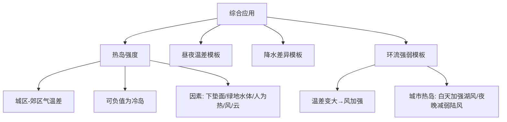

---
tags:
  - 地理/自然地理
  - 高中/大气
date: 2026-10-05
---

# 课时 8：综合应用与答题模板（热岛强度 · 区域气候分析）

> [!info] 核心原理
> - **热岛强度 = 城区气温 − 郊区气温**（可为**负值**，即"冷岛"）
> - 综合题万能结构：**条件（谁提供能量/物质）→ 过程（如何传递/转化）→ 结果（气温/降水/风如何变）**
> - 三大高频模板：**昼夜温差**（课时 2）、**降水差异**（课时 7）、**环流强弱变化**（课时 6）

## 一、热岛强度曲线判读（A 卷第 5 题）

**读图三看**：① 看**极值**（何时最强）② 看**变化趋势**（升降、拐点）③ 看**与其他曲线/季节的对比**。

> [!example] 例题 1
> 从热岛强度日变化曲线图判断该城市热岛效应最强的时段。
>
> **解**：由曲线可知，**冬季 18—22 时**该城市热岛强度最大（大于 1 ℃），**热岛效应最强**。
> 一般规律：热岛强度**夜晚 > 白天**、**冬季 > 夏季**（与太阳辐射、人类活动排放、风速等因素有关）。

## 二、影响热岛强度的因素（A 卷第 6 题）

| 因素 | 具体影响 |
|---|---|
| **下垫面性质** | 城区采用**浅色/高反射率材料**（白色屋顶、浅色路面）→ 减少太阳辐射吸收 → 地表温度降低；郊区沙漠面积大、吸收太阳辐射多 → 地表升温快 → 可能出现**负热岛（"冷岛"）** |
| **绿地与水体** | 城区因**绿地和水体的调节作用**，温度较低；郊区蒸发量远大于城区时，郊区温度下降 |
| **人类活动** | 城区夏季大量使用**空调**排放废热 → 城区温度**升高**，热岛增强 |
| **天气/降水** | 夏季风带来充沛降水，影响范围较大，**城区和郊区都会降温** → 热岛强度减弱 |
| **风** | 风速大时，城郊空气混合加强 → 热岛强度**减弱** |

> [!example] 例题
> 该城市西部为乌兰布和沙漠与沙漠，夏季沙漠地表吸热能力极强，气温在地方时 14—15 时达最高；而城区因绿地和水体的调节作用温度较低，可能形成"**冷岛**"。判断关于热岛强度影响因素说法的正误。
>
> **解**（逐项）：
> - 城区采用浅色或高反射率材料，会减少太阳辐射吸收、降低地表温度；郊区沙漠吸收太阳辐射多、增温快 → 城郊热力性质差异导致出现**负热岛强度** → 正确
> - 夏季风带来充沛降水，影响范围较大，城区和郊区**都会降温** → "只影响城区"类说法错误
> - 郊区蒸发量远大于城区 → 会导致**郊区温度下降** → 相应错误说法可排除
> - 城区夏季大量使用空调 → 排放废热 → 城区温度**升高**（不选）

## 三、三大答题模板

### 模板 1：分析某地昼夜温差大小
**天气（晴天削弱弱+保温弱 → 温差大；阴雨 → 温差小）+ 下垫面（水域比热容大 → 温差小；陆地 → 温差大）+ 地势（凸地温差小；凹地温差大）+ 海拔（高原：削弱强? 注意：高原削弱弱、保温弱 → 温差大）**

### 模板 2：分析某地降水多少/差异
**水汽（距海远近、蒸发、水域）+ 环流（季风、湖陆风、山谷风）+ 抬升（地形、对流、锋面）+ 凝结核 + 下垫面与人类活动**

### 模板 3：分析局地环流强弱变化
**找出温差变化 → 温差变大则该方向的风加强 → 温差变小则减弱**（配合"白天/夜晚""城市热岛叠加/削弱"）

## 四、综合题示例（A 卷第 21 题·湖区与城市）

> [!example] 例题（湖区降水、湖陆风强弱、8 月与 1 月气温差异）
> **(1) 分析该区域夏季某日夜间多降水的原因。**
> **答**：夏季，**季风带来丰富的水汽**；受**湖泊与陆地热力性质差异**的影响，**夜晚湖区盛行上升气流**，水汽易凝结形成降水。（6 分）
>
> **(2) 说明湖泊附近城市建成区的建设对湖陆风的影响及原因。**
> **答**：影响：**使湖风加强，陆风减弱**。
> 原因：由于城市的**热岛效应**，**白天增大了湖、陆之间的温差**，湖风加强；**夜晚减弱了湖、陆之间的温差**，使陆风减弱。（2 分）
>
> **(3) 分析该区域 8 月比 1 月气温日较差小的原因。**
> **答**：8 月降水较 1 月多、**云层较厚**，白天云层对太阳辐射的**削弱作用强**，夜晚**大气逆辐射强、保温作用好** → 气温日较差小；8 月气温较高、**冰雪融水多，湖泊面积大**，**湖泊对气温的调节作用强**（水体比热容大，升温降温都慢）→ 气温日较差小。（6 分）

**答题要点提炼**：
- 气候特征类：先"水汽/云量"，再"削弱与保温"，最后"下垫面调节"
- 环流强弱类：必须写"**温差怎么变 → 风怎么变**"，只写结论不得分
- 分点书写，每点"**现象 + 原因**"配对，对应分值

## 五、常见易错点

> [!warning] 易错警示
> - 热岛强度可为**负值**（"冷岛"），不要默认"城区一定更热"
> - 热岛强度**不是**由城市面积单独决定，要看**地表反射率、绿地水体、人为热排放、风速、云量**的综合
> - 湖水降温是"**升温慢/降温慢**"，不是"湖水温度永远低于气温"
> - 答"湖泊调节作用强"时必须落到**比热容大 → 升降温慢 → 昼夜（气温日）较差小**
> - 综合题分值提示点数（如"6 分"通常写 3 个方面），**分点 + 术语**得分最稳

## 六、思维导图

> [!tip] 自测
> 1. 用模板 3 解释"城市规模扩大后，夜晚郊区吹向城市的近地面风增强"。
> 2. 若某湖冬季湖面结冰，湖陆风会如何变化？为什么？