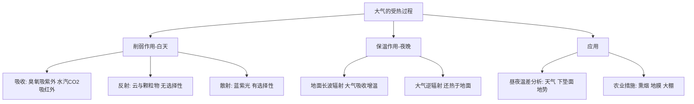
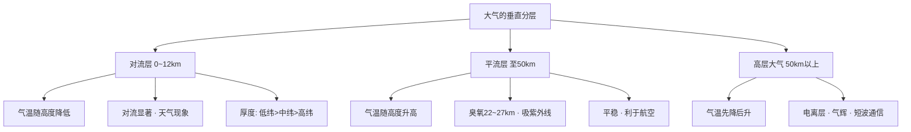
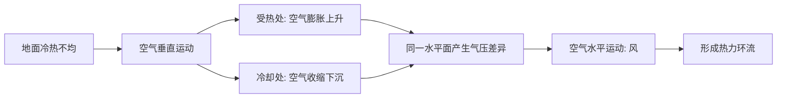
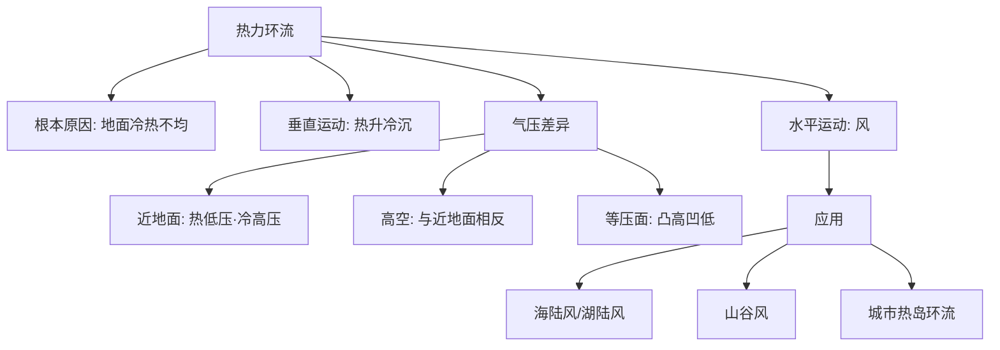
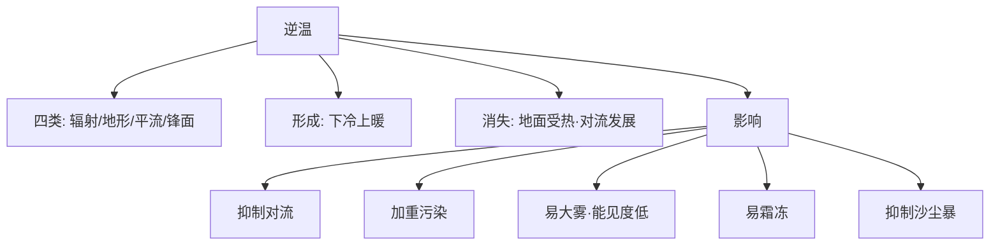
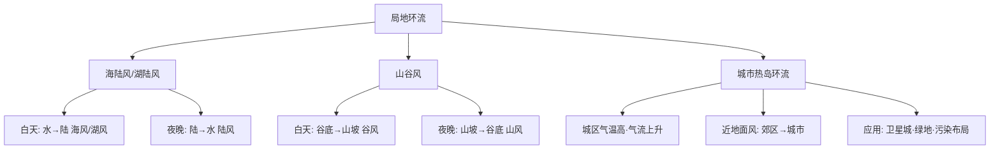
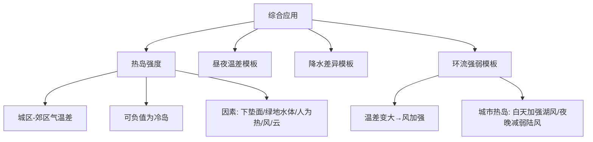

---
tags:
  - 地理/自然地理
  - 高中/大气
  - 合并笔记
date: 2026-10-05
aliases:
  - 大气专题课时1-8
  - 大气专题合并笔记
---

# 大气专题：课时 1—8 合并笔记

> [!abstract] 这份笔记是什么
> 把 [[00-大气专题总纲(MOC)|大气专题]] 的 8 个课时合并成一篇，方便通读与打印。
> 主线只有一条：**受热不均 → 垂直运动 → 水平气压差 → 风 → 环流 → 天气现象**。
> 单课时原文已归档在 git 历史里；本文件是唯一现行版本。

## 🧭 导航

| # | 课时 | 一句话核心 | 跳转 |
|---|---|---|---|
| ① | 大气的受热过程（削弱作用与保温作用） | 削弱（白天）+ 保温（夜晚） | [↑ 跳转](#①) |
| ② | 大气的垂直分层 | 气温怎么变 → 气流怎么动 → 天气怎么现 | [↑ 跳转](#②) |
| ③ | 热力环流原理与等压面判读 | 热升冷沉；近地面与高空相反；凸高凹低 | [↑ 跳转](#③) |
| ④ | 大气的水平运动与风向判读 | 梯度力定方向、偏向力偏转、摩擦力减速 | [↑ 跳转](#④) |
| ⑤ | 逆温现象及其影响 | 逆温 = 层结稳定 = 抑制对流 | [↑ 跳转](#⑤) |
| ⑥ | 局地环流（海陆风 · 湖陆风 · 山谷风 · 城市热岛环流） | 下垫面比热容差 → 昼夜温差 → 局地风 | [↑ 跳转](#⑥) |
| ⑦ | 大气成分、气溶胶、湿度与降水 | 气溶胶双重作用；比湿看对流 | [↑ 跳转](#⑦) |
| ⑧ | 综合应用与答题模板（热岛强度 · 区域气候分析） | 热岛强度、三大答题模板 | [↑ 跳转](#⑧) |

---

## ① 大气的受热过程（削弱作用与保温作用）

⬅️ [[00-大气专题总纲(MOC)|返回总纲]] · [[#②|下一课时 ➡️]]

> [!info] 核心原理
> - 能量链条：**太阳短波辐射 → 地面吸收（地面增温）→ 地面长波辐射 → 大气吸收（大气增温）→ 大气逆辐射（还热于地面）**
> - 两个关键结论：
>   - **近地面大气的直接热源是地面辐射**（不是太阳辐射！）
>   - **大气的两个作用 = 白天削弱、夜晚保温**，是解释所有气温、温差问题的总钥匙
> - 高频考法：昼夜温差大小、农业措施的天气学原理、云量对气温的影响、青藏高原"太阳辐射强而气温低"

### 一、受热过程的三个环节

| 环节 | 过程 | 原理与选择性 | 结果 |
|------|------|--------------|------|
| ① 太阳辐射到达地面 | 大气对太阳短波辐射的**削弱作用** | **吸收**（臭氧吸紫外、水汽和CO₂吸红外，有明显选择性）；**反射**（云层、颗粒物，无选择性）；**散射**（蓝紫光易散射，有选择性） | 削弱作用越强，**白天气温越低** |
| ② 地面吸收后增温并辐射 | 地面长波辐射（大部分被水汽、CO₂吸收） | 大气吸收地面长波辐射而增温 → **气温随高度升高而降低** | 对流层的直接热源是**地面** |
| ③ 大气逆辐射 | 大气辐射中射向地面的部分 | 云量多、水汽多、CO₂多 → 大气逆辐射强 | 逆辐射越强，**夜晚气温越高（保温强）** |

> [!tip] 一句话口诀
> **白天看削弱，夜晚看保温；云多削弱强、保温强 → 昼夜温差小。**

### 二、昼夜温差分析（通用答题维度）

| 角度 | 具体思路 | 温差 |
|------|----------|------|
| **天气状况** | 多晴朗天气 | 白天削弱弱、夜晚保温弱 | **温差大** |
| | 多阴雨天气 | 白天削弱强、夜晚保温强 | **温差小** |
| **下垫面** | 水域面积大 | 比热容大，增温与降温都慢 | **温差小** |
| | 陆地面面积大 | 比热容小，增温与降温都快 | **温差大** |
| **地势** | 山峰等凸地 | 海拔高、白天热量易散失、气温低；空气易下沉，但受地面降温影响小，夜晚温度变化小 | **温差小** |
| | 盆地等凹地 | 地形相对封闭，白天热量易聚集；夜晚冷空气下沉且受地面冷却影响 | **温差大** |
| **其他** | 植被覆盖率、积雪覆盖、湖泊/城市热岛 | 植被、积雪、水体→温差小；裸地、城市建成区→温差大 | — |

### 三、受热过程原理的应用

| 现象 / 措施 | 原理 |
|-------------|------|
| 农田**熏烟防霜冻** | 烟雾增强**大气逆辐射**，保温作用增强 |
| **地膜覆盖** | 减少地面长波辐射散失（阻隔地面与大气热量交换），起到保温保湿作用 |
| **温室大棚** | 玻璃/薄膜让太阳短波进入、阻挡地面长波散失 |
| **青藏高原**太阳辐射强、气温低 | 空气稀薄 → 削弱作用**弱**（辐射强），保温作用**弱**（气温低） |
| 云雨天气近地面气温较低（A卷第17题） | 云雨**削弱太阳辐射**，到达地面的热量减少 |
| 沙尘气溶胶（A卷第10题） | 吸收**地面辐射**使大气增温；作为**凝结核**促进云的发展；对太阳辐射的反射/散射增强会使大气散热，**不利于**加热深积云 |
| 塔里木盆地沙尘多但降水少（A卷第11题） | 沙尘气溶胶主要来自**干旱半干旱区**，水汽条件差，不利于降水 |

> [!example] 例题 1（对应 A卷第17题）
> 某日 16—18 时山地未形成上山气流，且附近有云雨层，分析原因。
>
> **答**：云雨**削弱太阳辐射**，使山坡地面温度较低，山坡与谷底温差小，**难以形成上升气流（谷风）**，故未形成上山气流。

> [!example] 例题 2（对应 A卷第21题第3问）
> 8 月降水较 1 月多，分析其对当地气温（昼夜温差）的影响。
>
> **答**：8 月降水多、**云层较厚**，白天云层对太阳辐射的**削弱作用强**，气温较低；夜晚大气逆辐射强、**保温作用好**，气温较高 → **昼夜温差较小**。同时 8 月气温高、冰雪融水多、湖泊面积大，湖泊对气温的**调节作用强**，也使温差变小。

### 四、常见易错点

> [!warning] 易错警示
> - **近地面大气的直接热源是地面辐射**，文字表述别写成"太阳辐射"
> - 反射**无选择性**（云层、颗粒物），散射**有选择性**（蓝紫光），吸收也**有选择性**
> - "削弱作用强 → 白天气温低"，"保温作用强 → 夜晚气温高"，两者**方向相反**，切勿混用
> - 只有"大气逆辐射"才对地面有保温作用，大气向上射向宇宙空间的长波辐射是**散热**
> - 分析温差题必须写全"白天＋夜晚"两个方向，只写一方会丢分

### 五、思维导图

---
## ② 大气的垂直分层

⬅️ [[#①|上一课时]] · [[#③|下一课时 ➡️]]

> [!info] 核心原理
> - 分层依据：**气温随高度的变化**（不是密度、不是成分）
> - 记忆总纲：**气温怎么变 → 气流怎么动 → 天气怎么现 → 人类怎么用**
> - 对流层厚度是**变量**：低纬 17~18 km ＞ 中纬 10~12 km ＞ 高纬 8~9 km，同地夏季 ＞ 冬季

### 一、三层大气对比表

| 分层 | 高度范围（中纬） | 气温垂直变化 | 气流运动 | 主要特征与人类活动 |
|---|---|---|---|---|
| **对流层** | 0 ~ 10~12 km（低纬 17~18 km，高纬 8~9 km） | 随高度升高而**降低**，平均每升高 100 m 降约 0.6 ℃ | **对流**显著 | 集中约 3/4 大气质量与几乎全部水汽、杂质；云、雨、雪、雾、雷电等**天气现象都发生在这一层** |
| **平流层** | 对流层顶 ~ 50 km | 随高度升高而**升高**（22~27 km 处**臭氧含量最大**，吸收紫外线增温） | 以**平流**为主（上热下冷，层结稳定） | 大气平稳、能见度好、水汽杂质少，**利于航空飞行** |
| **高层大气** | 50 km 以上 | 随高度升高**先降低、后升高** | — | 有**电离层**，反射无线电短波，影响无线电通信；出现**气辉**、极光、流星现象 |

### 二、气温垂直变化的判读方法（"剖线法"）

**步骤**：① 判断物体/光线经过的高度区间 → ② 判断区间落在哪一层 → ③ 套用该层气温变化规律 → ④ 串出整条气温变化曲线。

> [!example] 例题 1（A 卷第 2 题·灯光向太空传播）
> 航天员拍摄的城市灯光向太空传播，沿途气温怎样变化？
>
> **解**：灯光自下而上依次穿过 **对流层（降低）→ 平流层（升高）→ 高层大气（先降后升）**
> 结论：**先降低 → 后升高 → 再降低**。
> 干扰项手法：把"对流层气温随高度降低""平流层随高度升高"等片段裁剪后重新排列，逐层核对即可排除。

> [!example] 例题 2（A 卷第 1 题·"气辉"）
> "气辉"出现在地球上空 50~500 km 大气层中，是该层大气受太阳电磁辐射激发、获得电离能后微弱发光的现象。判断其发生的主要大气层。
>
> **解**：距地面约 **50 km 以上为高层大气** → 气辉主要发生在**高层大气**。
> （与电离层、极光同属高层大气现象，属"层—现象"对应记忆点。）

> [!example] 例题 3（A 卷第 4 题·层特征辨析）
> 判断关于各层特征说法的正误。
>
> **解**（逐项）：
> - 距地面 18~27 km 为**平流层**（不是对流层）→ 说法错
> - 云、雨等天气现象**多出现在对流层** → 正确
> - 对流层顶到 22~27 km 范围内**臭氧含量**达到最大值 → 正确（22~27 km 在平流层内）
> - 高层大气出现**电离**状态 → 正确

### 三、常见易错点

> [!warning] 易错警示
> - "气温随高度升高而升高"只对应**平流层**；高层大气是"**先降后升**"，别一律说成"升高"
> - **臭氧层在平流层**（22~27 km）、**电离层在高层大气**，两个"层"不能混
> - **天气现象只出现在对流层**；平流层"气流平稳、天气晴朗"
> - 海拔高 ≠ 对流层厚。对流层是"贴着地面"的这一层，其**顶部高度**才随纬度、季节变化
> - 对流层厚度影响因素：**纬度（低纬厚）、季节（夏季厚）、气温（近地面气温高则厚）、对流强弱**

### 四、思维导图

> [!tip] 自测
> 1. 为什么民航客机多在平流层巡航？
> 2. 同纬度地区，夏季与冬季对流层厚度哪个大？为什么？
> 3. 把"对流层→平流层→高层大气"的气温变化连成一条折线，最低点、最高点各在哪一层顶？

---
## ③ 热力环流原理与等压面判读

⬅️ [[#②|上一课时]] · [[#④|下一课时 ➡️]]

> [!info] 核心原理
> - 根本原因：**地面冷热不均**（太阳辐射的纬度/下垫面差异）
> - 形成顺序：**冷热不均 → 垂直运动 → 同一水平面气压差异 → 水平运动（风）**
> - 三句口诀：**热上升冷下沉；近地面与高空气压性质相反；等压面凸高凹低**

### 一、形成过程

### 二、等压线与等压面

| 概念 | 定义 |
|---|---|
| **等压线** | 同一高度上气压相等的各点连成的（闭合）曲线 |
| **等压面** | 空间气压相等的各点组成的面 |

**两条硬规则**：
1. **垂直方向**：近地面气压总是高于高空（同一地点，气压随高度递减）
2. **同一水平面**：等压面**向上凸**处为**高压**，**向下凹**处为**低压**（"凸高凹低"）；近地面与高空气压性质**相反**

### 三、气压高低判读五步法（A 卷第 13 题标注整理）

> [!example] 例题（冬季室内外等压面判读）
> **步骤**：
> 1. 明确概念：等压线是同一高度气压相等各点的连线；等压面是空间气压相等各点组成的面
> 2. **垂直比较**：近地面气压高于高空（图中的等压面数值自下而上减小：1000 → 1005 → 1010 → 1015 hPa）
> 3. **近地面比较**：根据地面冷热状况判断——**热低压、冷高压**。B 处（冷）气压大于 A 处（热）
> 4. **高空比较**：同一水平面用"凸高凹低"。C 处等压面**上凸** → C 处为**高压**；D 处等压面**下凹** → D 处为**低压**
> 5. 汇总：**B ＞ A ＞ C ＞ D**

**判读顺序小结**：先定"哪一侧冷、哪一侧热" → 再定近地面气压（冷高压、热低压）→ 高空用"凸高凹低" → 最后把四个点串起来比较。

> [!example] 例题（A 卷第 12 题·门帘飘动）
> 冬季东北地区室内外温差大，门口门帘飘动，体现的原理。
>
> **解**：属于**热力环流**。冬季室内暖 → 空气上升 → 室内近地面形成**低压**；室外冷 → 空气下沉 → 室外近地面形成**高压**；近地面气流由**室外流向室内**，故门帘被压向室内。
> 原理链条：温差 → 垂直运动 → 水平气压差 → 水平运动。

### 四、常见易错点

> [!warning] 易错警示
> - "热的地方气压低"只对**近地面**成立；**高空**恰好相反（受热处高空为高压）
> - 判断气压高低必须先**锁定同一水平面**，不能把近地面与高空直接比较大小
> - 等压面弯曲的判读："**凸高为高、凹低为低**"，别记成"凸起就是低压"
> - 风力大小看**等压线疏密**，不看温度高低（见课时 4）
> - 热力环流是**水平气压梯度力**驱动的结果，垂直运动只是"前提条件"

### 五、思维导图

> [!tip] 自测
> 1. 画一幅"城市—郊区"环流示意图，标出近地面与高空的等压面弯曲方向。
> 2. 若 A 地近地面气压高于 B 地，则 A、B 两地的高空气压谁高？为什么？

---
## ④ 大气的水平运动与风向判读

⬅️ [[#③|上一课时]] · [[#⑤|下一课时 ➡️]]

> [!info] 核心原理
> - **形成风的直接原因**：水平气压梯度力（垂直于等压线，由高压指向低压）
> - **高空风**：气压梯度力 + 地转偏向力 → 最终**与等压线平行**
> - **近地面风**：再加**摩擦力** → 最终**斜穿等压线**（夹角约 30°~45°）
> - **偏转规律**：北半球**右偏**，南半球**左偏**（沿力的方向看）

### 一、三种作用力对比

| 作用力 | 方向 | 作用结果 |
|---|---|---|
| **水平气压梯度力** | 垂直于等压线，高压 → 低压 | 形成风的**直接原因**，决定风的初始方向 |
| **地转偏向力** | 与风向垂直（北半球右、南半球左） | 使风向偏转，**不改变风速** |
| **摩擦力** | 与风向相反 | **减小风速**，使风斜穿等压线 |

### 二、风向判读三步法

1. **画梯度力**：在等压线图上找出高压、低压；画箭头**垂直等压线、由高压指向低压**
2. **判半球并偏转**：北半球向右偏、南半球向左偏；**高空**偏到与等压线平行，**近地面**偏成斜穿（约 30°~45°）
3. **定最终风向**：箭头所指方向即风的**来向**

> [!warning] 风向与去向
> "**吹东北风**"指**风从东北来**，物体/烟尘将向**西南**移动。做题时看清问的是"风向"还是"移动方向"。

**风力大小**：**等压线越密集 → 水平气压梯度力越大 → 风力越大**（与气压高低无关，与温度无关）。

> [!example] 例题 1（A 卷第 14、15 题·等压线图判读）
> 北半球某地等压线图，判断最可能的风向与孔明灯的飞行方向，并比较 ① ② 两地风力。
>
> **解**：
> - 水平气压梯度力由**高压指向低压**，北半球**向右偏**，最可能吹**西北风**
> - 风由西北吹向东南 → **孔明灯飞向东南**
> - ① 地等压线比 ② 地**密集** → ① 地水平气压梯度力更大、**风力更大**，孔明灯飞得更快

> [!example] 例题 2（A 卷第 19 题·由风向反推相对位置）
> 气象观测点 21 时至次日 6 时吹陆风（西南风），湖风为东南风或偏东风，判断观测点位于湖泊的哪一侧。
>
> **解**：
> - 陆风由**陆地吹向湖泊**，为**西南风** → 陆地位于观测点的西南方向
> - 湖风由**湖泊吹向陆地**，为**东南风/偏东风** → 湖泊位于观测点的东（东南）方向
> - 综合：**观测点位于湖泊西侧**

### 三、常见易错点

> [!warning] 易错警示
> - 风向描述用**来向**；"风吹向哪里"要用**去向**，两者差 180°
> - 判断风向必须同时判断**半球**；题干没给半球就用图上的纬度、海陆位置或等压线数值排序推
> - 高空风与等压线**平行**，近地面风**斜穿**等压线；不要一律画成垂直或平行
> - 等压线密集 ≠ 气压高。**稀疏处气压可能更高，但梯度力更小、风力更弱**
> - 湖陆风、海陆风判读时，先确定"水在哪一侧"，再套"白天水→陆、夜晚陆→水"（见课时 6）

> [!tip] 自测
> 1. 画出北半球近地面一点的风向示意图（标出三种力）。
> 2. 某地吹西南风，则该地的气压梯度力大致指向哪个方向？

---
## ⑤ 逆温现象及其影响

⬅️ [[#④|上一课时]] · [[#⑥|下一课时 ➡️]]

> [!info] 核心原理
> - **定义**：在对流层中，气温本应随高度升高而降低；若出现**气温随高度升高而升高**（或降温幅度明显减小）的现象，称为逆温
> - 逆温 = 大气层结**稳定**（上暖下冷），**抑制对流** → "稳定"是理解一切影响的钥匙
> - 逆温的**形成**靠"下冷上暖"，逆温的**消失**靠"地面受热、对流发展"

### 一、四类逆温对比

| 类型 | 形成条件 | 出现时间 / 地区 | 伴随现象 |
|---|---|---|---|
| **辐射逆温** | 晴朗无云的夜晚，**近地面大气降温快**，高处降温慢 | 中高纬度**大陆**地区，**日出前后最强** | 霜冻、晨雾、空气污染加重 |
| **地形逆温** | 山坡散热快，**冷空气沿山坡下沉到谷底**，谷底原来暖空气被抬升 | 夜间**山谷** | 常伴随**夜雨**，谷底多雾、易霜冻 |
| **平流逆温** | 暖空气水平流动到**冷的地面或水面**上，近地面空气接触冷却更快 | 冬季中纬度**沿海**地区 | 常伴随**海雾** |
| **锋面逆温** | **锋面之上**的暖空气与下面的冷空气形成"上暖下冷" | 锋面附近 | 锋面云系、锋面降水 |

### 二、逆温的生消过程（辐射逆温为例）

- **日落前后**：地面辐射冷却加强，近地面先降温 → 逆温自下而上形成
- **日出前后**：地面散热达到最强 → 逆温**最厚、最强**
- **日出后**：太阳辐射增强，地面增温 → 对流发展 → 逆温自下而上**逐渐消失**（打破稳定层结）

### 三、逆温的影响（四条必背）

1. **空气对流运动弱**（抑制对流），大气污染物不易扩散 → **加重大气污染**
2. 但同时可**抑制沙尘暴、扬尘**等发生（近地面大风与强对流被抑制）
3. **易出现大雾**，降低大气能见度（影响交通、航空）
4. **易出现霜冻**（冷空气下沉聚集、近地面气温低）

> [!example] 例题 1（A 卷第 7 题·天气现象成因）
> 判断关于稳定层结、强对流天气、城市热岛夜雨、逆温等说法的正误。
>
> **解**（逐项）：
> - 稳定的大气层结指**空气的垂直运动受到抑制**的状态；受热不均、层结不稳定引起上升运动形成**积状云** → 正确
> - 龙卷风、雷暴属于**强对流天气**，大气层结**不稳定**（不是稳定）→ 说法错
> - 城市热岛效应**多发于夜晚**：夜晚地面因地面辐射而失去热量，近地面大气冷却强烈，较高处大气冷却较慢，形成**逆温**，大气层结稳定 → 正确

> [!example] 例题 2（A 卷第 16 题·山谷风与逆温）
> 由图 a 可知 7—9 时山谷南北坡同时存在上升和下降气流，判断逆温消失的大致时间。
>
> **解**：
> - 逆温现象常出现在**夜晚或日出前**：山坡冷却快，冷空气沿山坡下沉至谷底，谷底气温较低、上方空气较暖 → 形成**地形（山谷）逆温**
> - 逆温**消失需要地面加热**，使谷底气温上升，打破稳定层结
> - 图 a 中 7—9 时南北坡**同时存在上升和下降气流**，说明正处于**山谷风转换**阶段，逆温仍存在
> - 10—15 时太阳辐射增强、地面加热明显，**谷风发展强盛**（气流由谷底沿山坡上升），此时逆温应**完全消失**
> - 结合选项：6 时可能仍处于逆温最强时段（日出前）；17 时开始出现逆温；**推测消失时间约 10 时**

> [!example] 例题 3（A 卷第 9 题·对流与稳定度）
> 若背景风（盛行风）较弱，白天气温升高后近地面比湿如何变化？为什么？
>
> **解**：气温升高 → **对流运动增强** → 近地面水汽被输送到高层 → 近地面**比湿减小**，午后达极小值；太阳辐射减弱后对流减弱，比湿回升。
> 反过来说：**逆温抑制对流**时，近地面水汽不易向上输送，近地面比湿反而偏高。

### 四、常见易错点

> [!warning] 易错警示
> - 逆温 ≠ 平流层"上热下冷"：逆温特指**对流层内**的异常现象
> - 逆温**强度最大的是日出前后**（不是午夜），因为地面整夜持续辐射冷却
> - 逆温影响"**有弊也有利**"：加重大气污染是弊；抑制沙尘暴、扬尘是利，不能只答一面
> - 山谷夜里易"**夜雨**"与谷底"**多雾**"看似矛盾，实际：谷底暖空气被抬升成云致雨（发生于谷底上方），而近地面因冷空气堆积多雾
> - 判读逆温是否消失，看**气流方向**（谷底→山坡上升为谷风）与**地面是否增温**

### 五、思维导图

> [!tip] 自测
> 1. 为什么四川盆地冬季多雾、空气质量偏差？
> 2. 用气温垂直变化曲线说明"日出前逆温最强、上午逐渐消失"的过程。

---
## ⑥ 局地环流（海陆风 · 湖陆风 · 山谷风 · 城市热岛环流）

⬅️ [[#⑤|上一课时]] · [[#⑦|下一课时 ➡️]]

> [!info] 核心原理
> - 一切局地环流都源于**下垫面热力性质差异**（比热容不同）→ 昼夜温差 → 热力环流
> - **陆风/海风记忆法**："**白天风从水面吹向陆地（海风、湖风），夜晚风从陆地吹向水面（陆风）**"
> - 判读三步：**定水体方位 → 判昼夜（谁热谁冷）→ 定风向与气流**

### 一、四类局地环流对比

| 类型 | 成因 | 白天 | 夜晚 |
|---|---|---|---|
| **海陆风** | 海陆比热容差异 | **海风**（海→陆） | **陆风**（陆→海） |
| **湖陆风** | 湖泊与陆地比热容差异（内陆湖泊更明显） | **湖风**（湖→陆） | **陆风**（陆→湖） |
| **山谷风** | 山坡与谷底受热/散热差异 | **谷风**（谷底→山坡） | **山风**（山坡→谷底） |
| **城市热岛环流** | 城市气温高于郊区（人类活动释放废热、下垫面、绿地少） | 近地面风由**郊区吹向城市**（全天如此） | 同左，夜晚更明显 |

### 二、湖陆风判读（A 卷第 18、19 题整理）

> [!example] 例题 1（A 卷第 18 题·表格逐项辨析）
> 某气象观测点测得的湖陆风资料，判断各项说法。
>
> **解**（逐项）：
> - 湖风（东南风或偏东风）风速**大于**陆风（西南风），且持续时间更长 → 正确
> - 21 时至次日 6 时吹**陆风**（西南风），6—8 时西南风转东南风 → 即**陆风转湖风** → 正确
> - 图中显示该湖岸区域 8—19 时吹**湖风**（东南风或偏东风），19—21 时东南风逐渐转偏南风，即**湖风转陆风**（"8—19 时吹湖风，19—21 时由东南风转偏南风"说明风向在 19 时后转变）→ 需按时间轴核对，**D 项说法与图示不符**

> [!example] 例题 2（A 卷第 19 题·由风向判断相对位置）
> 该气象观测点 21 时至次日 6 时吹陆风为**西南风**，湖风为**东南风或偏东风**，问观测点位于湖泊的哪一侧？
>
> **解**：
> - 陆风：**陆地 → 湖泊**，风向为西南风 → 陆地在其西南方
> - 湖风：**湖泊 → 陆地**，风向为东南风/偏东风 → 湖泊在其东（东南）方
> - 结论：**观测点位于湖泊西侧**（风向在 7 时左右发生明显变化，说明水陆热力差异发生转换）

### 三、湖陆风对城市建成区的影响（A 卷第 20 题）

> [!example] 例题
> 判断湖陆风对城市建成区影响的说法（正确项：白天湖风从湖泊吹向周围城市建成区，有明显降温效果，可缓解城市热岛效应）。
>
> **解**：
> - 白天湖泊升温慢（水温低）→ 湖面气压相对较高，**湖风从湖泊吹向周围城市建成区**，带来**降温、增湿**效果，**缓解城市热岛效应** → 正确
> - 夜晚陆地降温快，**陆风从城市建成区吹向湖泊**，会把城市热量/污染物带向湖区；"湖泊受人类活动影响小、空气质量较好"不能推出"湖风不会增强城区大气污染"这一附会结论 → 说法不成立

### 四、局地环流的应用（A 卷第 12、21 题）

- **城市楼群间风力较大**：楼群间形成"**狭管**"，气流通道变窄、风速增大（叠加城市热岛环流）
- **湖泊对城市的调节**：白天湖风**降温增湿**、缓解热岛；夜间陆风**减少城市对湖区的热排放**
- **城市热岛效应叠加湖陆风**：城市热岛使**白天湖陆温差增大 → 湖风加强**；**夜晚减小湖、陆温差 → 陆风减弱**（见 21 题(2)）
- **山谷夜间**：冷空气下沉堆积于谷底 → 易成雾；暖空气被抬升 → 常形成**夜雨**
- **卫星城与污染企业布局**：应位于城市热岛环流**之外**（避免污染物随近地面风回流城市）

> [!example] 例题（A 卷第 16 题·山谷风判读）
> **解**：7—9 时南北坡**同时存在上升和下降气流** → 正处于山谷风**转换**时刻（白天谷风、夜晚山风交替）；10—15 时地面加热明显、**谷风发展强盛** → 逆温完全消失。山谷风转换时间多在**日出后/日落前**。

### 五、常见易错点

> [!warning] 易错警示
> - 湖风/海风在**白天**，陆风在**夜晚**；不要把两者时间颠倒
> - 城市热岛环流的近地面风是"**郊区 → 城市**"，与"城市→郊区"的高空气流方向相反
> - 由风向反推相对位置时，必须**把风向转换为来向→源地**，再判断水体所在方位
> - 湖陆风、山谷风都属于**局地小尺度环流**，与季风（大尺度）成因不同：局地环流靠**昼夜热力差异**，季风靠**海陆热力差异随季节变化**
> - "风大小"比较看**持续时长与风速资料**，同时结合等压线/气压梯度力（课时 4）

### 六、思维导图

> [!tip] 自测
> 1. 若某地湖风为偏北风，则湖泊位于观测点的什么方位？
> 2. 城市热岛效应增强后，白天湖风与夜晚陆风分别如何变化？说明理由。

---
## ⑦ 大气成分、气溶胶、湿度与降水

⬅️ [[#⑥|上一课时]] · [[#⑧|下一课时 ➡️]]

> [!info] 核心原理
> - 大气组成：**干洁空气（N₂ 78%、O₂ 21%、CO₂、O₃）+ 水汽 + 杂质（气溶胶）**
> - 气溶胶（沙尘、烟尘）有**双重作用**：**削弱太阳辐射（降温）+ 吸收地面辐射（增温）+ 作为凝结核（成云致雨）**
> - **比湿**反映近地面水汽含量；比湿变化取决于**对流强弱**与**蒸发强弱**的对比

### 一、大气成分及其作用

| 成分 | 作用 |
|---|---|
| 氮（78%） | 生物体基本元素，性质稳定 |
| 氧（21%） | 生物维持生命活动必需 |
| **CO₂** | 光合作用原料；**吸收地面长波辐射 → 保温作用**（含量增加 → 全球变暖） |
| **O₃** | **吸收紫外线**，保护生物；集中在平流层（22~27 km） |
| **水汽、杂质** | 水汽**成云致雨的原料**，影响天气变化；杂质（气溶胶）**作凝结核**，并参与削弱与保温 |

### 二、气溶胶（含沙尘气溶胶）的作用

| 作用方向 | 具体表现 | 结果 |
|---|---|---|
| 对**太阳短波辐射**：反射、散射 | 削弱到达地面的太阳辐射（"阳伞效应"） | **地面降温**（也减小昼夜温差中的白天升温） |
| 对**地面长波辐射**：吸收 | 增强大气对地面辐射的吸收 → 大气增温 | **大气增温**，同时增强大气逆辐射（保温） |
| 作为**凝结核** | 促进水汽凝结，促进云的发展 | 有利于**降水**（云量、降水几率增加） |

> [!example] 例题 1（A 卷第 10 题·沙尘气溶胶的作用）
> 判断沙尘气溶胶作用的正确组合。
>
> **解**：
> - **①** 沙尘气溶胶能够**吸收地面辐射**，从而增强大气对地面辐射的吸收，使大气加热 → 正确
> - **②** 作为**凝结核**，能够增加水汽凝结、促进云的发展 → 正确
> - **③④** "大气向上的长波辐射增强""大气对太阳短波辐射的反射增强"会使**大气散热**，不利于加热深积云 → 错误
> - 结论：**①② 组合正确**（即选项 A）

> [!example] 例题 2（A 卷第 11 题·区域降水形成的特征差异）
> 判断沙尘气溶胶对区域降水影响的说法。
>
> **解**：
> - 沙尘气溶胶主要来源于**干旱和半干旱地区**（沙漠、荒漠化地区、内蒙古高原等地），这些地区**沙尘天气较常见** → 正确
> - 塔里木盆地地处干旱区，降水少；四川盆地和东南丘陵气候湿润，**沙尘气溶胶对降水的影响较小** → 正确
> - "沙尘气溶胶通过加热效应可**促进深积云发展**，从而增大降水" → 正确（但不能推广为"沙尘一定使降水增多"）
> - 关键区分：**气溶胶只是条件之一**，降水能否形成还要看**水汽条件、抬升条件**

### 三、比湿与湿度日变化（A 卷第 8、9 题）

**比湿**：单位质量湿空气中水汽的质量（g/kg），反映空气的水汽含量。

> [!example] 例题 1（A 卷第 8 题·城市与郊区比湿读图）
> **解**（逐项）：
> - 该日北京城区和郊区比湿变化**不完全一致** → 正确
> - 该日城区比湿最大值与最小值的差值，与郊区最大值与最小值的差值**接近** → 正确
> - 该日**夜晚**大多数时间郊区比湿**高于**城区 → 正确
> - 白天郊区比湿**高于**城区（**不是"低于"**）→ 读图结论要按曲线高低逐段核对

> [!example] 例题 2（A 卷第 9 题·受热过程与对流对比湿的影响）
> **解**：
> 日出后太阳辐射增强、近地面气温升高 → **对流运动增强** → 近地面水汽输送到高层 → **近地面比湿减小**，午后达**极小值**；随太阳辐射减弱、对流减弱 → 近地面比湿**增大**（夜间还可能回升）。
> 夜间近地面气温降低、对流减弱 → 近地面水汽易于**聚集**，比湿可能增加。

### 四、区域降水差异的分析角度（答题模板）

1. **水汽条件**：距海远近、气温高低、蒸发强弱、植被与水域面积
2. **气流/环流条件**：季风、局地环流（湖陆风、山谷风）、锋面
3. **抬升条件**：地形抬升、对流上升、锋面抬升
4. **凝结核条件**：气溶胶/沙尘、尘埃
5. **下垫面与人类活动**：湖泊调节、城市热岛、地表反射率

### 五、常见易错点

> [!warning] 易错警示
> - 气溶胶"**降温**"与"**增温**"两条同时存在：反驳"只增温"或"只降温"的绝对化说法
> - CO₂、水汽是**温室气体**（吸收地面长波辐射），O₃ 主要在**平流层吸紫外**，功能不要张冠李戴
> - 沙尘"促进降水"要看**水汽与抬升**是否具备；干旱区沙尘多，但降水依然少
> - 比湿是**水汽含量指标**，与**相对湿度**（饱和度指标）不同：气温升高时饱和水汽压升高，相对湿度可能下降
> - 读图题要**分段读**（白天段、夜间段），不要只凭整体趋势下结论

> [!tip] 自测
> 1. 用"削弱 + 吸收 + 凝结核"三条说明一次沙尘过程对区域气温与降水的影响。
> 2. 城市绿地增加后，城区比湿会怎样变化？为什么？

---
## ⑧ 综合应用与答题模板（热岛强度 · 区域气候分析）

⬅️ [[#⑦|上一课时]] · [[00-大气专题总纲(MOC)|返回总纲]]

> [!info] 核心原理
> - **热岛强度 = 城区气温 − 郊区气温**（可为**负值**，即"冷岛"）
> - 综合题万能结构：**条件（谁提供能量/物质）→ 过程（如何传递/转化）→ 结果（气温/降水/风如何变）**
> - 三大高频模板：**昼夜温差**（课时 2）、**降水差异**（课时 7）、**环流强弱变化**（课时 6）

### 一、热岛强度曲线判读（A 卷第 5 题）

**读图三看**：① 看**极值**（何时最强）② 看**变化趋势**（升降、拐点）③ 看**与其他曲线/季节的对比**。

> [!example] 例题 1
> 从热岛强度日变化曲线图判断该城市热岛效应最强的时段。
>
> **解**：由曲线可知，**冬季 18—22 时**该城市热岛强度最大（大于 1 ℃），**热岛效应最强**。
> 一般规律：热岛强度**夜晚 > 白天**、**冬季 > 夏季**（与太阳辐射、人类活动排放、风速等因素有关）。

### 二、影响热岛强度的因素（A 卷第 6 题）

| 因素 | 具体影响 |
|---|---|
| **下垫面性质** | 城区采用**浅色/高反射率材料**（白色屋顶、浅色路面）→ 减少太阳辐射吸收 → 地表温度降低；郊区沙漠面积大、吸收太阳辐射多 → 地表升温快 → 可能出现**负热岛（"冷岛"）** |
| **绿地与水体** | 城区因**绿地和水体的调节作用**，温度较低；郊区蒸发量远大于城区时，郊区温度下降 |
| **人类活动** | 城区夏季大量使用**空调**排放废热 → 城区温度**升高**，热岛增强 |
| **天气/降水** | 夏季风带来充沛降水，影响范围较大，**城区和郊区都会降温** → 热岛强度减弱 |
| **风** | 风速大时，城郊空气混合加强 → 热岛强度**减弱** |

> [!example] 例题
> 该城市西部为乌兰布和沙漠与沙漠，夏季沙漠地表吸热能力极强，气温在地方时 14—15 时达最高；而城区因绿地和水体的调节作用温度较低，可能形成"**冷岛**"。判断关于热岛强度影响因素说法的正误。
>
> **解**（逐项）：
> - 城区采用浅色或高反射率材料，会减少太阳辐射吸收、降低地表温度；郊区沙漠吸收太阳辐射多、增温快 → 城郊热力性质差异导致出现**负热岛强度** → 正确
> - 夏季风带来充沛降水，影响范围较大，城区和郊区**都会降温** → "只影响城区"类说法错误
> - 郊区蒸发量远大于城区 → 会导致**郊区温度下降** → 相应错误说法可排除
> - 城区夏季大量使用空调 → 排放废热 → 城区温度**升高**（不选）

### 三、三大答题模板

#### 模板 1：分析某地昼夜温差大小
**天气（晴天削弱弱+保温弱 → 温差大；阴雨 → 温差小）+ 下垫面（水域比热容大 → 温差小；陆地 → 温差大）+ 地势（凸地温差小；凹地温差大）+ 海拔（高原：削弱强? 注意：高原削弱弱、保温弱 → 温差大）**

#### 模板 2：分析某地降水多少/差异
**水汽（距海远近、蒸发、水域）+ 环流（季风、湖陆风、山谷风）+ 抬升（地形、对流、锋面）+ 凝结核 + 下垫面与人类活动**

#### 模板 3：分析局地环流强弱变化
**找出温差变化 → 温差变大则该方向的风加强 → 温差变小则减弱**（配合"白天/夜晚""城市热岛叠加/削弱"）

### 四、综合题示例（A 卷第 21 题·湖区与城市）

> [!example] 例题（湖区降水、湖陆风强弱、8 月与 1 月气温差异）
> **(1) 分析该区域夏季某日夜间多降水的原因。**
> **答**：夏季，**季风带来丰富的水汽**；受**湖泊与陆地热力性质差异**的影响，**夜晚湖区盛行上升气流**，水汽易凝结形成降水。（6 分）
>
> **(2) 说明湖泊附近城市建成区的建设对湖陆风的影响及原因。**
> **答**：影响：**使湖风加强，陆风减弱**。
> 原因：由于城市的**热岛效应**，**白天增大了湖、陆之间的温差**，湖风加强；**夜晚减弱了湖、陆之间的温差**，使陆风减弱。（2 分）
>
> **(3) 分析该区域 8 月比 1 月气温日较差小的原因。**
> **答**：8 月降水较 1 月多、**云层较厚**，白天云层对太阳辐射的**削弱作用强**，夜晚**大气逆辐射强、保温作用好** → 气温日较差小；8 月气温较高、**冰雪融水多，湖泊面积大**，**湖泊对气温的调节作用强**（水体比热容大，升温降温都慢）→ 气温日较差小。（6 分）

**答题要点提炼**：
- 气候特征类：先"水汽/云量"，再"削弱与保温"，最后"下垫面调节"
- 环流强弱类：必须写"**温差怎么变 → 风怎么变**"，只写结论不得分
- 分点书写，每点"**现象 + 原因**"配对，对应分值

### 五、常见易错点

> [!warning] 易错警示
> - 热岛强度可为**负值**（"冷岛"），不要默认"城区一定更热"
> - 热岛强度**不是**由城市面积单独决定，要看**地表反射率、绿地水体、人为热排放、风速、云量**的综合
> - 湖水降温是"**升温慢/降温慢**"，不是"湖水温度永远低于气温"
> - 答"湖泊调节作用强"时必须落到**比热容大 → 升降温慢 → 昼夜（气温日）较差小**
> - 综合题分值提示点数（如"6 分"通常写 3 个方面），**分点 + 术语**得分最稳

### 六、思维导图

> [!tip] 自测
> 1. 用模板 3 解释"城市规模扩大后，夜晚郊区吹向城市的近地面风增强"。
> 2. 若某湖冬季湖面结冰，湖陆风会如何变化？为什么？

---
## 🧷 全专题一页速查

| 主题 | 必须背下的硬结论 |
|---|---|
| 受热过程 | 近地面直接热源是**地面辐射**；削弱看白天，保温看夜晚 |
| 垂直分层 | 对流层递减、平流层递增、高层先降后升；天气只在对流层 |
| 热力环流 | 热低压冷高压（近地面）；高空相反；等压面凸高凹低 |
| 水平运动 | 高空与等压线平行，近地面斜穿 30°~45°；北右南左 |
| 逆温 | 日出前后最强；抑制对流 → 污染重、多雾、易霜冻、抑沙尘 |
| 局地环流 | 白天水→陆，夜晚陆→水；白天谷→坡，夜晚坡→谷 |
| 成分降水 | 气溶胶升温和降温并存；成雨仍要水汽 + 抬升 + 凝结核 |
| 综合应用 | 热岛强度可为负；答环流强弱必写"温差怎么变 → 风怎么变" |

## 🔗 相关

- [[00-大气专题总纲(MOC)]] —— 课时索引与记忆地图
- [[地理通用方法论]] —— 框架 / 因果链 / 证据提取
- [[必修一总述]] · [[必修二总述]] —— 教材全书复习
