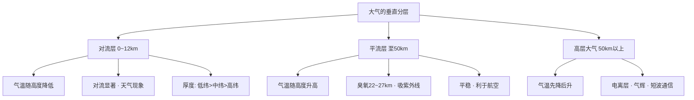

---
tags:
  - 地理/自然地理
  - 高中/大气
date: 2026-10-05
---

# 课时 1：大气的垂直分层

> [!info] 核心原理
> - 分层依据：**气温随高度的变化**（不是密度、不是成分）
> - 记忆总纲：**气温怎么变 → 气流怎么动 → 天气怎么现 → 人类怎么用**
> - 对流层厚度是**变量**：低纬 17~18 km ＞ 中纬 10~12 km ＞ 高纬 8~9 km，同地夏季 ＞ 冬季

## 一、三层大气对比表

| 分层 | 高度范围（中纬） | 气温垂直变化 | 气流运动 | 主要特征与人类活动 |
|---|---|---|---|---|
| **对流层** | 0 ~ 10~12 km（低纬 17~18 km，高纬 8~9 km） | 随高度升高而**降低**，平均每升高 100 m 降约 0.6 ℃ | **对流**显著 | 集中约 3/4 大气质量与几乎全部水汽、杂质；云、雨、雪、雾、雷电等**天气现象都发生在这一层** |
| **平流层** | 对流层顶 ~ 50 km | 随高度升高而**升高**（22~27 km 处**臭氧含量最大**，吸收紫外线增温） | 以**平流**为主（上热下冷，层结稳定） | 大气平稳、能见度好、水汽杂质少，**利于航空飞行** |
| **高层大气** | 50 km 以上 | 随高度升高**先降低、后升高** | — | 有**电离层**，反射无线电短波，影响无线电通信；出现**气辉**、极光、流星现象 |

## 二、气温垂直变化的判读方法（"剖线法"）

**步骤**：① 判断物体/光线经过的高度区间 → ② 判断区间落在哪一层 → ③ 套用该层气温变化规律 → ④ 串出整条气温变化曲线。

> [!example] 例题 1（A 卷第 2 题·灯光向太空传播）
> 航天员拍摄的城市灯光向太空传播，沿途气温怎样变化？
>
> **解**：灯光自下而上依次穿过 **对流层（降低）→ 平流层（升高）→ 高层大气（先降后升）**
> 结论：**先降低 → 后升高 → 再降低**。
> 干扰项手法：把"对流层气温随高度降低""平流层随高度升高"等片段裁剪后重新排列，逐层核对即可排除。

> [!example] 例题 2（A 卷第 1 题·"气辉"）
> "气辉"出现在地球上空 50~500 km 大气层中，是该层大气受太阳电磁辐射激发、获得电离能后微弱发光的现象。判断其发生的主要大气层。
>
> **解**：距地面约 **50 km 以上为高层大气** → 气辉主要发生在**高层大气**。
> （与电离层、极光同属高层大气现象，属"层—现象"对应记忆点。）

> [!example] 例题 3（A 卷第 4 题·层特征辨析）
> 判断关于各层特征说法的正误。
>
> **解**（逐项）：
> - 距地面 18~27 km 为**平流层**（不是对流层）→ 说法错
> - 云、雨等天气现象**多出现在对流层** → 正确
> - 对流层顶到 22~27 km 范围内**臭氧含量**达到最大值 → 正确（22~27 km 在平流层内）
> - 高层大气出现**电离**状态 → 正确

## 三、常见易错点

> [!warning] 易错警示
> - "气温随高度升高而升高"只对应**平流层**；高层大气是"**先降后升**"，别一律说成"升高"
> - **臭氧层在平流层**（22~27 km）、**电离层在高层大气**，两个"层"不能混
> - **天气现象只出现在对流层**；平流层"气流平稳、天气晴朗"
> - 海拔高 ≠ 对流层厚。对流层是"贴着地面"的这一层，其**顶部高度**才随纬度、季节变化
> - 对流层厚度影响因素：**纬度（低纬厚）、季节（夏季厚）、气温（近地面气温高则厚）、对流强弱**

## 四、思维导图

> [!tip] 自测
> 1. 为什么民航客机多在平流层巡航？
> 2. 同纬度地区，夏季与冬季对流层厚度哪个大？为什么？
> 3. 把"对流层→平流层→高层大气"的气温变化连成一条折线，最低点、最高点各在哪一层顶？