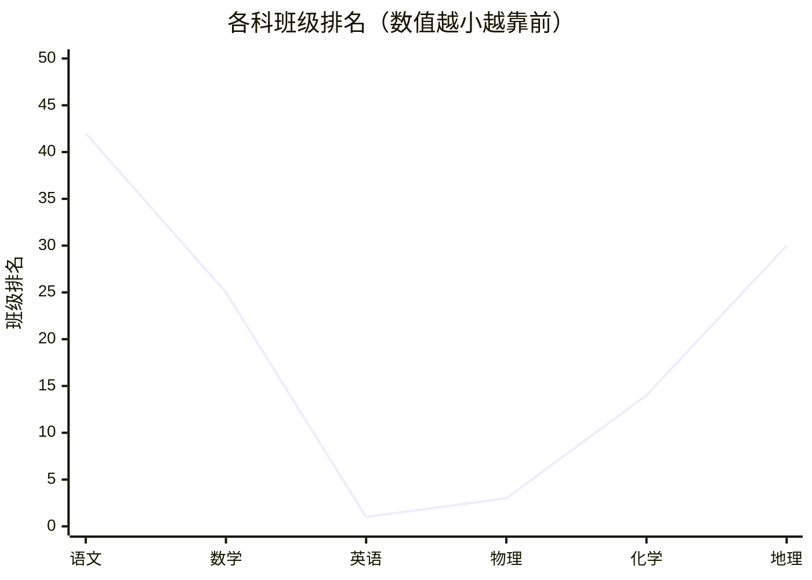

---
tags:
  - 成绩分析/考试
  - 高中/高一下
date: 2026-05-28
---

# 高一考试学业质量分析报告

> 考试时间：2026-05-25 | 班级：— | 考号：—  
> 总分（原始分）：456/750 | 班级排名：9/49 | 学校排名：659/1734 | 全体排名：17949/81578  
> 超过特控线30分，距离211线还差52分

---

## 📊 总分概况

- **班级排名**：第9名 / 49人（超过83.67%学生）  
- **学校排名**：第659名 / 1734人（超过62.05%学生）  
- **全体排名**：第17949名 / 81578人（超过78%学生）  

本次考试分数线：清北线663分，985线572分，211线544分，特控线462分，本科线389分。

---

## 📈 各科成绩总览

| 科目 | 原始分/满分 | 等级 | 班名次 | 校名次 | 全体名次 |
|------|-------------|------|--------|--------|----------|
| 语文 | 80/150 | B | 42/49 | 1827/1935 | 45365/99685 |
| 数学 | 83/150 | A | 25/48 | 1094/1931 | 10801/99491 |
| 英语 | 125/150 | - | 1/48 | 71/1930 | 1858/97443 |
| 物理 | 60/100 | - | 3/49 | 119/1730 | 5626/81428 |
| 化学（赋分） | 73/100 | B | 14/48 | 1029/1727 | 33156/81326 |
| 地理（赋分） | 71/100 | B | 30/48 | 224/347 | 13337/27421 |

### 各科班级排名折线图

---

## 🔍 逐科分析

### 一、语文B（80/150，班42名）

| 知识点 | 得分/满分 | 得分率 | 班级平均得分率 | 差值 |
|--------|-----------|--------|----------------|------|
| 字形 | 1/3 | 33.33% | 48.98% | -15.65% |
| 词义 | 3/3 | 100% | 81.63% | +18.37% |
| 关联词语 | 2/3 | 66.67% | 87.07% | -20.4% |
| 病句辨析 | 0/4 | 0% | 16.33% | -16.33% |
| 看法建议 | 3/5 | 60% | 66.94% | -6.94% |
| 名篇名句默写 | 2/6 | 33.33% | 55.1% | -21.77% |
| 文学类文本阅读 | 5/16 | 31.25% | 47.45% | -16.2% |
| 非连续性文本 | 8/19 | 42.11% | 56.39% | -14.28% |
| 文言文阅读 | 8/22 | 36.36% | 52.32% | -15.96% |
| 诗词内容理解 | 5/9 | 55.56% | 59.64% | -4.08% |
| 材料作文 | 43/60 | 71.67% | 70.05% | +1.62% |

**主要失分点**：病句辨析（0分）、名句默写（33%）、文言文（36%）、文学类文本（31%）。

---

### 二、数学A（83/150，班25名）

| 知识点 | 得分/满分 | 得分率 | 班级平均得分率 | 差值 |
|--------|-----------|--------|----------------|------|
| 平面向量数量积 | 15/20 | 75% | 59.38% | +15.62% |
| 解三角形 | 4/17 | 23.53% | 19.36% | +4.17% |
| 解三角形实际应用 | 0/5 | 0% | 45.83% | -45.83% |
| 复数对应点 | 13/13 | 100% | 71.47% | +28.53% |
| 复数混合运算 | 0/6 | 0% | 54.17% | -54.17% |
| 棱柱结构特征 | 5/5 | 100% | 35.42% | +64.58% |
| 圆台结构特征 | 2/6 | 33.33% | 43.75% | -10.42% |
| 线面位置关系 | 0/5 | 0% | 68.75% | -68.75% |
| 线面角 | 4/15 | 26.67% | 34.72% | -8.05% |
| 二面角 | 10/17 | 58.82% | 22.55% | +36.27% |
| 样本数字特征 | 6/15 | 40% | 77.36% | -37.36% |

**严重失分**：解三角形实际应用（0分）、复数混合运算（0分）、线面位置关系（0分）、样本数字特征（远低于班级平均）。

---

### 三、英语（125/150，班第1名）

| 知识点 | 得分/满分 | 得分率 | 班级平均得分率 | 差值 |
|--------|-----------|--------|----------------|------|
| 记叙文 | 23/25 | 92% | 64.79% | +27.21% |
| 说明文 | 20/20 | 100% | 61.2% | +38.8% |
| 应用文 | 7.5/7.5 | 100% | 79.17% | +20.83% |
| 选句填空 | 7.5/12.5 | 60% | 59.17% | +0.83% |
| 电子邮件 | 10.5/15 | 70% | 51.32% | +18.68% |
| 读后续写 | 17.5/25 | 70% | 40.13% | +29.87% |
| 语法填空 | 12/15 | 80% | 52.92% | +27.08% |

**优势**：说明文满分，所有题型得分率均高于班级平均。  
**提升点**：选句填空、电子邮件可进一步巩固。

---

### 四、物理（60/100，班第3名）

| 知识点 | 得分/满分 | 得分率 | 班级平均得分率 | 差值 |
|--------|-----------|--------|----------------|------|
| 自由落体运动 | 8/8 | 100% | 63.27% | +36.73% |
| 平抛运动 | 4/4 | 100% | 48.98% | +51.02% |
| 平抛与斜面结合 | 10/10 | 100% | 71.22% | +28.78% |
| 斜抛运动 | 0/4 | 0% | 12.24% | -12.24% |
| 向心力 | 4/4 | 100% | 20.41% | +79.59% |
| 万有引力定律应用 | 3/23 | 13.04% | 11.98% | +1.06% |
| 机车启动 | 6/6 | 100% | 62.24% | +37.76% |
| 动能定理 | 4/12 | 33.33% | 16.5% | +16.83% |
| 能量守恒 | 3/6 | 50% | 29.59% | +20.41% |
| 圆周运动探究 | 5/6 | 83.33% | 77.21% | +6.12% |
| 验证机械能守恒 | 5/9 | 55.56% | 18.37% | +37.19% |

**需突破**：斜抛运动（0分）、万有引力综合题（13%）、第15题（全班得分率仅0.72%）。

---

### 五、化学人教（原始52/100，赋分73/100，班14名）

| 知识点 | 得分/满分 | 得分率 | 班级平均得分率 | 差值 |
|--------|-----------|--------|----------------|------|
| 化学方程式书写 | 0/3 | 0% | 43.75% | -43.75% |
| 燃料电池 | 1/4 | 25% | 51.56% | -26.56% |
| 化学反应原理综合 | 6/10 | 60% | 37.92% | +22.08% |
| 二氧化硫性质 | 4/15 | 26.67% | 31.39% | -4.72% |
| 醇的性质 | 0/6 | 0% | 19.1% | -19.1% |
| 基本营养物质 | 0/3 | 0% | 64.58% | -64.58% |
| 有机物结构与性质 | 3/9 | 33.33% | 38.19% | -4.86% |
| 制备实验设计 | 1/9 | 11.11% | 23.61% | -12.5% |

**严重失分**：化学方程式书写（0分）、基本营养物质（0分）、醇的性质（0分）、制备实验设计（11%）。

---

### 六、地理（原始56/100，赋分71/100，班30名）

| 知识点 | 得分/满分 | 得分率 | 班级平均得分率 | 差值 |
|--------|-----------|--------|----------------|------|
| 城市化 | 0/3 | 0% | 62.5% | -62.5% |
| 农业发展方向 | 3/6 | 50% | 71.88% | -21.88% |
| 服务业类型与发展 | 0/6 | 0% | 48.96% | -48.96% |
| 交通运输区位 | 4/9 | 44.44% | 55.32% | -10.88% |
| 环境问题产生原因 | 0/3 | 0% | 70.83% | -70.83% |
| 环境问题危害措施 | 3/6 | 50% | 56.25% | -6.25% |
| “一带一路”应用 | 8/14 | 57.14% | 48.21% | +8.93% |
| 生态环境问题 | 2/6 | 33.33% | 50% | -16.67% |

**零分失分项**：城市化、服务业类型与发展、环境问题产生原因（与班级平均差距巨大）。  
**优势项**：“一带一路”应用略高于班级平均。

---

## 📌 总结与建议

### 优势科目
- **英语**（班级第1）：保持听力和阅读训练，作文继续打磨。
- **物理**（班级第3）：力学基础扎实，但斜抛和万有引力需专题突破。

### 弱势科目
- **语文**（班42）：重点攻克病句辨析、名句默写、文言文翻译和文学类文本答题技巧。
- **地理**（班30）：强化人文地理模块（城市化、服务业、环境问题），背诵标准答题术语。
- **化学**（班14但原始分低）：回归教材，默写化学方程式，掌握有机化学基础（醇、营养物质）和实验设计思路。

### 整体提升计划
1. **错题本**：每科建立错题本，每周重做错题。  
2. **专项训练**：针对薄弱知识点（解三角形实际应用、复数运算、斜抛、万有引力、方程式书写、服务业区位）进行小专题练习。  
3. **限时模拟**：每周一次限时套卷训练，提高答题速度和准确率。  
4. **规范答题**：语文和英语注意书写与格式，读后续写多积累情节模板。  

**目标**：补齐短板，稳定优势，下次考试冲入班级前5，跨越211线（544分）。
