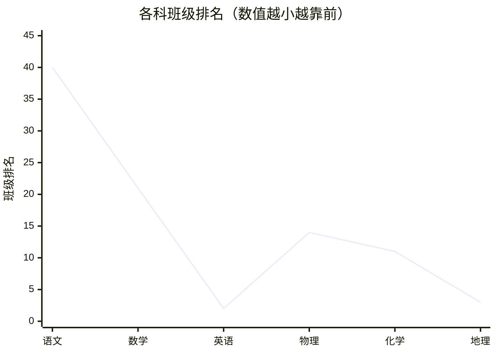

---
tags:
  - 成绩分析/考试
  - 高中/高一下
date: 2026-07-10
---

# 高一下期末学业质量分析报告（2026-07-10）

> 总分（原始分）：493.5 | 班级排名：6/若干 | 学校排名：458 | 市级排名：835 | 全体排名：8453
>
> 总分（赋分）：522.5 | 班级排名：7 | 学校排名：611 | 市级排名：1158 | 全体排名：11464

---

## 📈 各科成绩总览

| 科目 | 原始分 | 赋分 | 等级 | 全体名次 | 市级名次 | 校名次 | 班名次 |
|------|--------|------|------|----------|------------|--------|--------|
| 语文 | 82.5 | — | — | 63185 | 7060 | 1647 | 40 |
| 数学 | 84 | — | — | 17552 | 2037 | 919 | 21 |
| 英语 | 129 | — | — | 1291 | 191 | 124 | 2 |
| 物理 | 50 | — | — | 21615 | 2192 | 862 | 14 |
| 化学 | 65 | 83 | B | 16268 | 1555 | 780 | 11 |
| 地理 | 83 | 94 | A | 40 | 7 | 3 | 3 |

> [!info] 总分汇总
> | 口径 | 分数 | 全体名次 | 市级名次 | 校名次 | 班名次 |
> |------|------|----------|------------|--------|--------|
> | 总分（原始） | 493.5 | 8453 | 835 | 458 | 6 |
> | 总分（赋分） | 522.5 | 11464 | 1158 | 611 | 7 |

---

## 📊 各科班级排名折线图

---

## 🔍 简要观察

- **优势科目**：地理（赋分 94，班 3 / 全校 3 / 全体第 40，全市第 7）、英语（129，班 2）——稳定强项，保持即可。
- **中等科目**：数学（84，班 21）、化学（赋分 83，班 11）、物理（原始 50，班 14）。
- **薄弱科目**：语文（82.5，班 40）——与期中（班 42）一致，是需要长期投入的短板。
- **对比期中**：总分由 456 → 493.5（原始），班排名 9 → 6，整体有进步；地理由 B 提升到 A。

> [!tip] 待补充
> 逐科知识点得分率明细尚未整理，可与期中报告同格式补齐。
