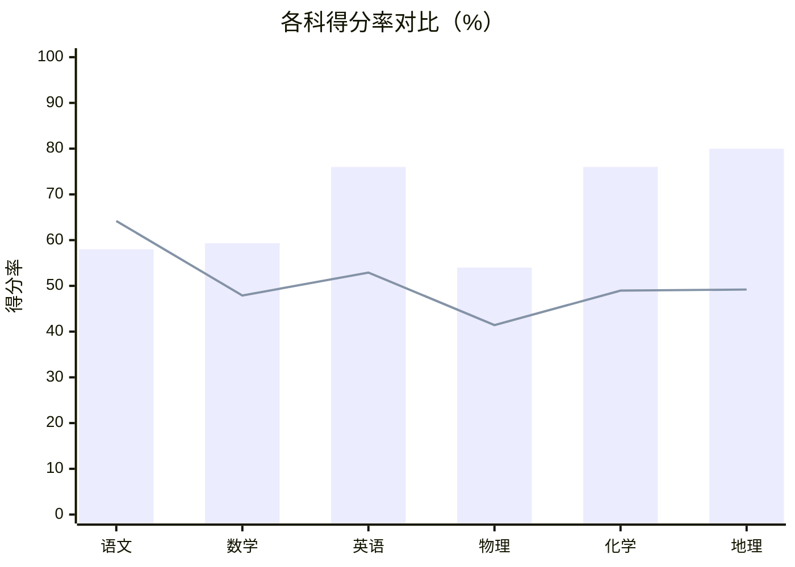

---
tags:
  - 成绩分析/考试
  - 高中/高二上
date: 2026-10-13
---

# 高二上第一次月考学业质量分析报告（2026-10-13）

> 考试：2026101314 安鹤新高二 | 选科：物化地 | 市级高中 6 班 · 考号 —
>
> 总分（计入口径）：**500 / 750** | 得分率 66.67% | 全体位次 **1477** | 超过 74.08% 同学，处于全体前 **25.92%**
>
> 下次目标：**525 分**（+25），冲击全体前 21%

> [!warning] 本场难度偏难
> 全体均分收窄，各科客观题/主观题得分率分化明显。本次未上线，提分缺口 25 分的路径已拆解。

---

## 📈 各科成绩总览

| 科目 | 得分/满分 | 得分率 | Z分数 | 班均分 | 与班均差 | 校排 | 全体均分 | 全体位次 |
|------|-----------|--------|-------|--------|----------|------|----------|----------|
| 语文 | 87/150 | 58.00% | **-0.71** | 93.98 | -6.98 | 1521 | 96.29 | 前 66.98% |
| 数学 | 89/150 | 59.33% | +0.58 | 67.61 | +21.39 | 609 | 71.86 | 前 28.03% |
| 英语 | 114/150 | 76.00% | **+1.47** | 81.99 | +32.01 | 112 | 79.36 | 前 5.58% |
| 物理 | 54/100 | 54.00% | +0.65 | 34.46 | +19.54 | 421 | 41.43 | 前 24.72% |
| 化学（原始55） | 76/100 | 76.00% | +0.32 | 67.89 | +8.11 | 764 | 48.96 | 前 35.28% |
| 地理（原始62） | 80/100 | 80.00% | +0.73 | 78.41 | +1.59 | 62 | 49.20 | 前 11.34% |

> [!info] 客观题 / 主观题得分率（判断"概念不牢"还是"表达不规范"）
> | 科目 | 客观题 | 主观题 |
> |------|--------|--------|
> | 语文 | 40.00% | 62.50% |
> | 数学 | 51.72% | 64.13% |
> | 英语 | 75.26% | 77.27% |
> | 物理 | 71.74% | 38.89% |
> | 化学 | 64.29% | 48.28% |
> | 地理 | 75.00% | 50.00% |

> [!note] 赋分说明
> 化学、地理按等级赋分后计入总分，表格得分即计入口径成绩（原始分：化学 55、地理 62）。

---

## 📊 各科超过全体考生比例（能力雷达）

多边形顶点 = 各科超过全体考生比例，越外越强：最强 **英语（前 5.58%）**，最弱 **语文（前 66.98%）**。

> 柱 = 你的得分率，线 = 全体均分折算得分率。

---

## 🔍 核心结论（4 件事）

1. **定位**：总分 500，全体第 1477 名，超过 74.08% 同学；地理、英语处于顶尖优势，偏科涨分空间充足。
2. **核心特征**：得分率 66.67%，主要差距在 **语文（Z = -0.71，六科最低）**。
3. **提分空间**：理论可争取 25 分，瓶颈学科 = 语文，靠"补基础 + 提中档"实现。
4. **建议**：稳英语/地理优势盘，优先补语文基础漏洞，突破数学、物理中档题型，锁定 525 分。

> [!danger] 失分构成（本次失分 289 分）
> | 档位 | 失分 | 说明 |
> |------|------|------|
> | 基础型 | 38.00 | 多数同学都会做，必须拿回 |
> | 提升型 | 81.00 | 中等难度，主攻 |
> | 挑战型 | 109.00 | 较高难度，量力而行 |
> | 拔高型 | 61.00 | 高难度区分题，战略取舍 |

---

## 🎯 各科目标与失分构成

| 科目 | 当前 | 目标 | 需提升 | 失分构成（基础/提升/挑战/拔高） |
|------|------|------|--------|--------------------------------|
| 语文 | 87 | 95.00 | +8.00 | 30 / 18 / 9 / 6 |
| 数学 | 89 | 95.50 | +6.50 | 0 / 13 / 32 / 16 |
| 英语 | 114 | 122.00 | +8.00 | 5 / 16 / 8 / 7 |
| 物理 | 54 | 58.50 | +4.50 | 0 / 9 / 19 / 18 |
| 化学（原始55） | 76 | 84.00 | +8.00 | 3 / 14 / 26 / 2 |
| 地理（原始62） | 80 | 85.50 | +5.50 | 0 / 11 / 15 / 12 |

> [!tip] 目标测算口径
> 基础型 80% + 提升型 50%，单科封顶 8 分、总分封顶 25 分——一个月现实可达目标。

---

## 🧠 你的学习特质（答题数据反推）

- **基础扎实**：英语全班第 1、全体前 5.58%，地理全体前 11.34%，是冲分核心基本盘。
- **作答均衡**：全学科无空白卷，除个别压轴题外均有效作答，答题习惯好、无主动放弃。
- **学科差异明显**：语文仅超过 33.02% 同学，比全体均分低 9.29，与英语差距极大，是总分上台阶最大阻碍。

---

## 📉 知识点归因（你 vs 全体）

| 科目 | 知识点 | 题号 | 失分 | 占该科 | 你的得分率 | 全体 | 差值(pp) |
|------|--------|------|------|--------|-----------|------|----------|
| 语文 | 非连续性文本 | 选择1-5 | 12.00 | 36.40% | 36.84% | 57.32% | -20.50 |
| 语文 | 小说 | 选择6/7,8,9 | 12.00 | 36.40% | 25.00% | 57.31% | -32.30 |
| 数学 | 圆方程的综合应用 | 第19题 | 16.00 | 41.00% | 5.88% | 20.06% | -14.20 |
| 数学 | 虚数单位i及其性质 | 选择9 | 6.00 | 15.40% | 0.00% | 62.95% | -63.00 |
| 物理 | 含容电路分析 | 第13题 | 10.00 | 43.50% | 0.00% | 29.99% | -30.00 |
| 物理 | 周期性变化电场中直线运动 | 选择10 | 6.00 | 26.10% | 0.00% | 28.36% | -28.40 |
| 化学 | 转化率随温度/压强变化曲线 | 选择12,14,18(2-3) | 12.00 | 44.40% | 14.29% | 41.62% | -27.30 |
| 化学 | 电化学综合 | 第15(4-5) | 6.00 | 22.20% | 25.00% | 38.43% | -13.40 |

> 推进四步：知识点 → 教材章节 → 专题训练 → 错题回做。

---

## ⭐ 最该拿回的分数（净失分 Top）

| # | 科目·题号 | 类型 | 你/满分 | 全体得分率 | 净失分 |
|---|-----------|------|---------|-----------|--------|
| 1 | 数学·选择9 | 提升型·主攻 | 0/6 | 62.95% | 3.78 |
| 2 | 数学·选择7 | 提升型·主攻 | 0/5 | 60.93% | 3.05 |
| 3 | 物理·13 | 挑战型·提分 | 0/10 | 29.99% | 3.00 |
| 4 | 数学·19 | 拔高型·长期 | 1/17 | 20.06% | 2.41 |
| 5 | 语文·选择6 | 基础型·必补 | 0/3 | 78.16% | 2.34 |
| 6 | 数学·选择11 | 挑战型·提分 | 0/6 | 37.37% | 2.24 |
| 7 | 数学·选择10 | 挑战型·提分 | 0/6 | 35.59% | 2.14 |
| 8 | 化学·选择14 | 基础型·必补 | 0/3 | 66.34% | 1.99 |
| 9 | 物理·15 | 拔高型·长期 | 0/15 | 13.17% | 1.98 |
| 10 | 语文·选择19 | 基础型·必补 | 0/3 | 65.71% | 1.97 |
| 11 | 物理·选择2 | 提升型·主攻 | 0/4 | 48.37% | 1.93 |
| 12 | 语文·17 | 基础型·必补 | 2/6 | 65.25% | 1.92 |
| 13 | 化学·16(1-2) | 提升型·主攻 | 4/10 | 57.49% | 1.75 |
| 14 | 英语·选择31 | 基础型·必补 | 0/2.5 | 69.28% | 1.73 |

> **净失分** =（全体得分率 − 你的得分率）× 该题满分，是这份报告的排序依据——比绝对失分更能说明"会做但没拿到"。

---

## 🧭 学习优先级矩阵

| 投放顺序 | 象限 | 具体内容 |
|----------|------|----------|
| **① 立刻做** | 高权重 + 易 | 语文·非连续性文本19分、语文·小说16分、数学·虚数i性质6分、数学·选择9 6分、化学·16(1-2) 6分 |
| **② 长期训练** | 高权重 + 难 | 数学·圆方程综合17分、数学·19 16分、物理·15 15分、化学·转化率曲线14分、物理·含容电路10分 |
| **③ 顺手捡分** | 低权重 + 易 | 物理·选择2 4分、语文·词语辨析3分、语文·选择6 3分、化学·选择14 3分、语文·选择19 3分、语文·选择1 3分 |
| **④ 随堂跟进** | 低权重 + 难 | 物理·电容定义式4分、化学·吸热放热3分、地理·地球公转意义3分、化学·选择13 3分、化学·选择3 3分、地理·选择10 3分 |

---

## 💊 行动处方（按提分性价比排序）

### 1️⃣ 语文 [需提升] 87 → +8 分

- **诊断**：客观题正确率仅 40%，6 道选择得 0 分；基础型累计丢 30 分；现代文（非连续+小说）失分占该科 73%，最大拖分项；作文 45 分，还有 15 分可追。
- **怎么做**：
  - 每天 2 篇现代文阅读专项，逐字对照参考答案采分点，修正答题表述逻辑。
  - 每周滚动复习 3 轮必背古诗文，先把名句默写失分清零（零成本拿满 6 分）。
  - 整理近 3 套语文选择错题，总结词语辨析、病句干扰项设置规律。

### 2️⃣ 英语 [优势学科] 114 → +8 分

- **诊断**：班第 1，超过 94.42% 同学，领先全体均分 34.64，优势突出；客观题仅丢 7 道；写作 18 分，还有 7 分可提升。
- **怎么做**：
  - 每天 1 篇完形 + 2 篇常规阅读维持手感，不额外加码。
  - 每周积累 5 个高考写作场景高级句型，替换口语化表达。
  - 把 7 道高难度错题整理进专属错题本，每周复盘 1 次。

### 3️⃣ 化学 [稳定学科] 76 → +8 分

- **诊断**：超 64.72% 同学，领先全体均分 6.04；基础型仅丢 3 分，挑战型丢 26 分，核心漏洞在转化率曲线类；主观题得分率 < 50%（步骤不规范）。
- **怎么做**：
  - 每天 5 道化学平衡图像选择题，总结曲线升降、交点判断规律。
  - 对照标准答案梳理主观题标准采分表述，养成踩点作答。
  - 每周 1 套化学选择限时训练，选择板块失分控制在 3 分内。

---

## 🗓️ 未来四周怎么做

| 周次 | 主题 | 任务 |
|------|------|------|
| 第 1 周 | 扫阻 | 清理语文、数学所有基础型错题，回收约 30 分无门槛失分 |
| 第 2 周 | 补基础 | 攻克语文现代文、化学平衡图像、数学基础选择漏洞，回收提升型 70%，摸到 510+ |
| 第 3 周 | 攻中档 | 主攻数学、物理挑战型中档题，回收挑战型 30 分，突破 520 |
| 第 4 周 | 练规范 | 全科打磨主观题规范，纠正非知识性失分，稳定 525+ |

### 每日精力投放（按 150 分钟折算）

| 学科 | 占比 | 时间 | 提分 |
|------|------|------|------|
| 语文 | 20% | 30 分钟 | +8 |
| 英语 | 20% | 30 分钟 | +8 |
| 化学 | 20% | 30 分钟 | +8 |
| 数学 | 16% | 24 分钟 | +6.50 |
| 地理 | 14% | 20 分钟 | +5.50 |
| 物理 | 11% | 17 分钟 | +4.50 |

### 总分提升 → 位次对照

| 总分提高 | 可达名次 | 超越人数 |
|----------|----------|----------|
| +5 | 1,382 | 95 |
| +10 | 1,300 | 177 |
| +20 | 1,143 | 334 |
| +30 | 1,002 | 475 |
| +50 | 723 | 754 |

---

## ✅ 每日 3 件必做小事

1. **语文·选择6**（8 分空间）：每天 10 分钟 1 道现代文阅读选择，对照解析整理干扰项逻辑，7 天拉满正确率。
2. **英语·选择31**（8 分空间）：每天 5 分钟复盘完形错题，梳理熟词生义搭配，同类题不再出错。
3. **化学·选择14**（8 分空间）：每天 10 分钟 1 道化学平衡选择，总结温压曲线判断技巧，两周正确率 90%+。

---

## 🏁 4 周后进步画像（按 80% 执行率估算）

- **成绩**：500 → **525**（+25）；位次 1477 → 前 25.92%；跨入更高分数段门槛。
- **语文**：失分 63 → 收窄；Z 分数从 -0.71 提升到 0 以上。
- **学习习惯**："做完必检查"成为习惯，粗心率 < 5%；建立错题本，每周复盘 ≥ 5 道；每天 60 分钟专项 + 周末 90 分钟综合卷。

> [!check] 每周打勾（4 周共 4 次）
> - [ ] 1. 基础题"做完必检查"成为习惯（粗心率 < 5%）
> - [ ] 2. 错题本已建立，每周整理 ≥ 5 道典型错题
> - [ ] 3. 语文每周训练 ≥ 3 次，每次 30 分钟
> - [ ] 4. 每周一测完成 4 张，进步曲线可追踪
> - [ ] 5. 回归教材已完成 2 次，对齐概念定义
> - [ ] 6. 压轴题训练 8 道，整理出 2-3 类解题模板

**达成度**：≥ 4 项打勾 = 阶段成功；< 3 项 = 复盘策略。

---

## 📝 六条提醒

1. 优先补语文基础型失分（本次基础题丢 30 分，性价比最高）。
2. 英语已全班第 1，每天 30 分钟常规练习即可，不挤占弱科时间。
3. 数学圆方程综合题本次仅得 1 分（丢 16 分），每周练 2 道同类压轴第一问，先把第一问拿住。
4. 物理含容电路 10 分大题得 0，难度不高，花 2 天过一遍教材至少拿回 6 分。
5. 总分已 500，补齐 25 分缺口即可稳冲 525，进入全体前 25%。
6. 所有净分排名靠前的高价值错题建专属错题本，每周末集中复盘一次。

---

> 本报告由联考成绩数据自动生成 | 数据源：2026101314 安鹤新高二 · 本人 —（市级高中 6 班）| 生成日期：2026-10-15
